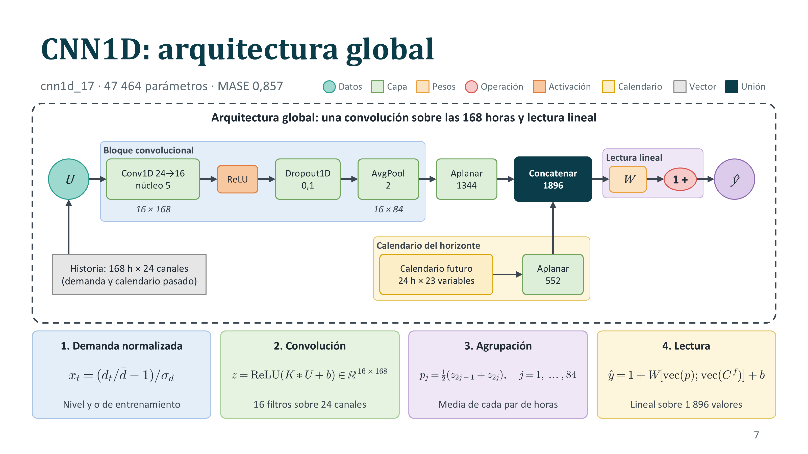
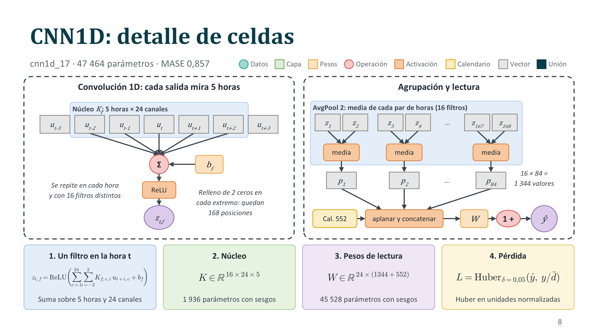

(e2-cnn1d)=
# 10.5. CNN1D: filtros locales sobre la historia

La {ref}`notación y las operaciones compartidas <fundamentos-arquitecturas>` definen los tensores, el nivel de demanda, la atención, las activaciones y la optimización.

## Arquitectura y fundamentos

La CNN1D busca patrones cortos, como una rampa o un cambio de pendiente, mediante filtros compartidos en todas las posiciones. Compartir pesos permite detectar una forma similar en distintas horas. La agregación posterior combina esas respuestas con el calendario de las horas que se pronostican.

La red seleccionada tiene una sola convolución de 16 filtros y núcleo de cinco horas sobre 24 canales de entrada. Se añade relleno simétrico de dos posiciones para conservar la longitud de 168. Después de ReLU y dropout por canal de 0,1, un promedio de dos horas reduce la longitud a 84. Los $16\times84=1.344$ atributos se concatenan con los 552 del calendario futuro; una capa $1.896\rightarrow24$ produce las correcciones. El total es de 47.464 parámetros.

$$z_{s,c}=\operatorname{ReLU}\!\left(b_c+\sum_{j=1}^{24}\sum_{i=-2}^{2}K_{cij}x_{s+i,j}\right),\quad
\widehat{\mathbf y}=\ell_t\left[\mathbf1+W[\operatorname{vec}(\operatorname{AvgPool}_2z);\operatorname{vec}(F)]+b\right].$$

El filtro no es causal dentro de la ventana, porque utiliza posiciones vecinas a izquierda y derecha. Esto no implica consultar el horizonte: todas las posiciones de la ventana son anteriores al origen. Es diferente de la TCN, que sí impone causalidad en cada convolución. La capa final reúne toda la historia filtrada, mientras que el campo local de cada filtro es de cinco horas. Se ajusta con Huber y AdamW; los escaladores y los pesos restaurados se mantienen fijos al evaluar.

### Esquema global

[](../_static/arquitecturas_presentacion/cnn1d_global.png)

La convolución extrae patrones locales de la demanda y del calendario pasado. La agrupación reduce la historia; su representación se combina con el calendario futuro para obtener 24 correcciones.

### Detalle de las operaciones

[](../_static/arquitecturas_presentacion/cnn1d_detalle.png)

Cada filtro consulta cinco posiciones de la historia y los 24 canales de entrada. AvgPool combina pares de horas; los 1.344 atributos resultantes y los 552 del calendario alimentan la lectura lineal.

El {ref}`código de exportación de los esquemas <exportacion-esquemas>` forma parte del preprocesamiento compartido.

### Código de la arquitectura

```{literalinclude} ../_static/codigo_e2/cnn1d_red.py
:language: python
:linenos:
```

## Pipeline de entrenamiento y prueba

La configuración utilizada por esta familia es:

```json
{
  "id": "cnn1d_17",
  "ventana": 168,
  "params": {
    "capas": 1,
    "dropout": 0.1,
    "weight_decay": 0.0001,
    "batch_size": 256,
    "lr": 0.0003,
    "scheduler": "plateau",
    "perdida": "huber",
    "paciencia": 6,
    "filtros": 16,
    "kernel": 5
  }
}
```

El procedimiento separa ajuste, parada interna y evaluación externa, estima las transformaciones únicamente en ajuste y restaura el mínimo de parada. La función admite validación o prueba con autorización explícita y conserva las salidas en una carpeta nueva. Los bloques siguientes documentan el código; construir el libro no ejecuta entrenamientos.

### Escalado por pliegue y optimización

```{literalinclude} ../_static/codigo_e2/base/src/demanda/reentrenamiento_v3.py
:language: python
:linenos:
```


El siguiente bloque vincula las implementaciones mostradas y permite seleccionar CPU o GPU sin funciones exclusivas del sistema operativo. La inicialización del dispositivo se conserva en resolver_dispositivo.

```python
from pathlib import Path
import json,sys
import numpy as np
import pandas as pd

def ejecutar_configuracion(raiz, familia, semilla=1000, dispositivo='auto',
                          fase='validacion', anio=2021, permitir_prueba=False,
                          salida=None):
    raiz=Path(raiz).resolve()
    procedencia=json.loads((raiz/'results/jbook/modelos_actualizados.json').read_text())
    fuentes=raiz/'results/repositorio'/procedencia['commit']
    sys.path.insert(0,str(fuentes/'src'))
    from demanda import modelos_base as M, particion as P
    from demanda import reentrenamiento_v3 as motor
    from demanda.variantes_v4 import Secuencial as Recurrente
    from demanda.metricas import evaluar
    import torch
    registro=json.loads((fuentes/'results/consolidado/modelos.json').read_text())
    config=registro[familia]['configuracion']
    panel=pd.read_parquet(raiz/'data/processed/panel_horario.parquet')
    variables=json.loads((fuentes/'data/processed/feature_registry.json').read_text())
    cfg=M.ConfigDatos(ventana=config['ventana'])
    if fase=='prueba':
        if not permitir_prueba:raise PermissionError('La prueba requiere acceso explícito')
        tr,es=P.pretest(panel.index,ventana=cfg.ventana)
        ev=P.origenes(panel.index,'test',ventana=cfg.ventana,allow_test=True)
    else:
        fold=P.folds_forward_chaining(panel.index,[anio],ventana=cfg.ventana)[0]
        tr,es,ev=fold['tr'],fold['es'],fold['val']
    datos=motor.DatosFold(panel,variables,cfg,tr,secuencial=familia in ('lstm','cnn1d'))
    train,stop,evaluacion=[datos.conjunto_pos(p) for p in [tr,es,ev]]
    assert train.origen.max()+pd.Timedelta(hours=23)<stop.origen.min()
    assert stop.origen.max()+pd.Timedelta(hours=23)<evaluacion.origen.min()
    assert pd.Timestamp(datos.auditoria['fin_ajuste'])<stop.origen.min()
    fabrica=motor.Secuencial
    try:
        if familia=='lstm':motor.Secuencial=Recurrente
        modelo=motor.Entrenador(familia)
        info=modelo.ajustar(train,stop,datos,config['params'],semilla,
                           M.Opciones(max_epocas=60,dispositivo=dispositivo,hilos=2))
    finally:
        motor.Secuencial=fabrica
    pred=datos.invertir(modelo.predecir(evaluacion),evaluacion)
    metricas=evaluar(evaluacion.y,pred,datos.escala_mase)
    if salida is not None:
        destino=Path(salida)/familia/str(semilla)/str(anio if fase=='validacion' else fase)
        destino.mkdir(parents=True,exist_ok=False)
        escala=datos.escaladores()
        torch.save({'state_dict':{k:v.detach().cpu() for k,v in modelo.red.state_dict().items()},
                    'modelo':familia,'params':config['params'],'escaladores':escala},
                    destino/'modelo.pt')
        np.savez_compressed(destino/'predicciones.npz',y=evaluacion.y,yhat=pred,
                            origen=evaluacion.origen.as_unit('ns').asi8)
        for nombre,objeto in [('escaladores',escala),('historia',info['historia']),
                              ('metricas',metricas)]:
            (destino/(nombre+'.json')).write_text(json.dumps(objeto,ensure_ascii=False,
                                                indent=2,default=str),encoding='utf-8')
    return modelo,datos,evaluacion,pred,info,metricas

# Selección: comparar el MASE medio de confirmación, sin leer prueba.
# Piloto: repetir cada configuración seleccionada con semillas 100–104
# en los cuatro años externos. Final: semillas 1000–1004 con acceso explícito.
# El argumento salida conserva pesos, escaladores, curvas, métricas y predicciones.

```


Para esta página, `familia` toma el valor `cnn1d`. Las definiciones completas de datos y métricas se muestran en el {ref}`preprocesamiento compartido <fundamentos-arquitecturas>`; los cuerpos de las redes y del bucle de ajuste están visibles en esta página.

## Evaluación

Los resultados de esta familia se integran en la {ref}`evaluación estadística conjunta <evaluacion-e2>`, con métricas por semilla, horizonte y origen. La comparación distingue las entradas demanda/calendario de las entradas numéricas ampliadas y el aporte de texto oficial.

## Fuentes

La formulación y las dimensiones se verifican en las clases del código mostrado.. La descripción corresponde a la implementación del experimento; las adaptaciones se identifican en el texto.
