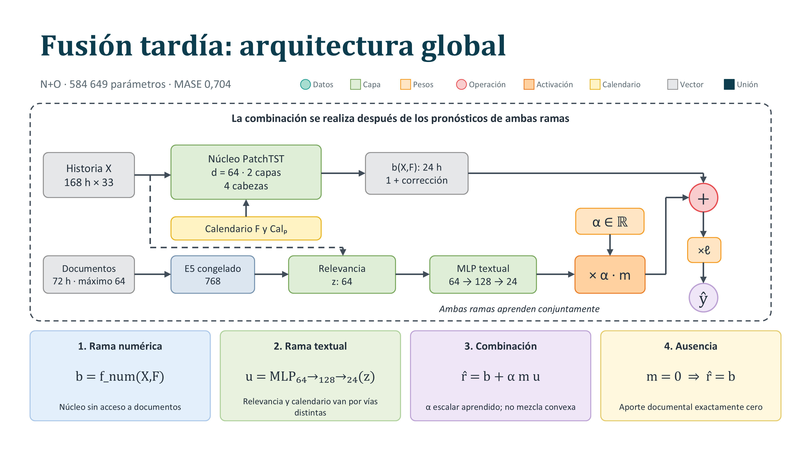
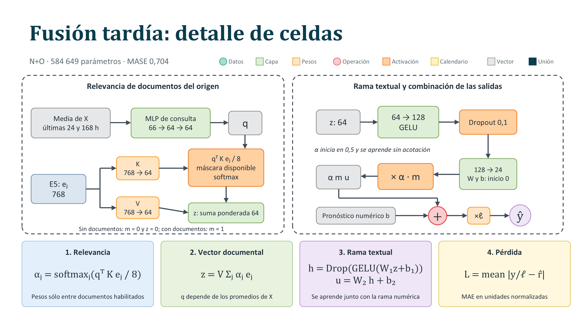

(e2-fusion)=
# 10.13. Fusión tardía de pronósticos numéricos y textuales

La {ref}`notación y las operaciones compartidas <fundamentos-arquitecturas>` definen los tensores, el nivel de demanda, la atención, las activaciones y la optimización.

## Arquitectura y fundamentos

La fusión tardía mantiene dos caminos hasta la salida: uno produce un pronóstico con la serie y el calendario; el otro propone un aporte basado en documentos. La combinación se realiza después de ambos cálculos. Esto contrasta con TaTS, que introduce el texto dentro de la secuencia que procesa el núcleo.

El núcleo seleccionado es PatchTST de dimensión 64, dos capas y cuatro cabezas, con cabeza lineal de demanda y MLP de contexto. Los documentos oficiales disponibles en las 72 horas anteriores al origen se ponderan por relevancia aprendida. El resumen de dimensión 64 pasa por una capa de 128, GELU, dropout y una salida de 24. Un escalar $\alpha$ aprendido combina las ramas:

$$
\widehat{\mathbf r}=b(X,F)+\alpha\,m_t\,g(z_t),\qquad
\widehat{\mathbf y}=\ell_t\widehat{\mathbf r}.
$$ (eq-arquitecturas-fusion-001)

La última capa textual se inicializa en cero y $\alpha$ en 0,5; el modelo empieza con el pronóstico numérico. Sin documentos, $m_t=0$ y la contribución textual es exactamente cero para los mismos pesos del núcleo. Ambas ramas se entrenan conjuntamente: no se congela la base. Por ello, esa identidad no garantiza igualdad con un checkpoint numérico entrenado por separado.

La suma no es una mezcla convexa: $\alpha$ no está restringido a [0,1] y la rama textual puede tener cualquier signo. Tampoco es la corrección residual acotada del diseño de investigación: aquí no hay radio $\rho$ ni garantía de deterioro acotado. La configuración contiene 584.649 parámetros. Su control sin texto coincide en las cinco predicciones con el control numérico de TaTS y se identifica como una única referencia en el benchmark, conservando la trazabilidad de ambos paquetes.

### Esquema global

[](../_static/arquitecturas_presentacion/fusion_global.png)

Una rama PatchTST procesa la historia numérica y el calendario, mientras otra transforma un resumen de documentos oficiales en 24 correcciones. Ambas ramas se ajustan conjuntamente; un escalar aprendido pondera la contribución textual antes de sumar las salidas.

### Detalle de las operaciones

[](../_static/arquitecturas_presentacion/fusion_detalle.png)

La rama documental utiliza una consulta numérica para ponderar los embeddings disponibles y un MLP de dimensiones 64, 128 y 24. Su última capa inicia en cero; el escalar comienza en 0,5 y se aprende sin acotación. El indicador de presencia anula exactamente la contribución documental cuando falta texto.

El {ref}`código de exportación de los esquemas <exportacion-esquemas>` forma parte del preprocesamiento compartido.

### Código de la arquitectura

```{literalinclude} ../_static/codigo_e2/fusion_red.py
:language: python
:linenos:
```

<!-- diseno-entrenamiento:inicio -->

## Diseño de entrenamiento y prueba

(diseno-entrenamiento-fusion)=

### Selección en validación

Se evaluaron **20 configuraciones** y 5 llegaron a la comparación de selección. La **configuración 18** obtuvo el menor MASE de validación (0,5250) sobre 2018–2021. La configuración fijada para prueba es **18**, con 5 semillas.

#### Configuración conservada
| Parámetro | Valor |
|---|---|
| Núcleo | patchtst |
| Dimensión interna | 64 |
| Capas | 2 |
| Cabezas | 4 |
| Dropout | 0,1 |
| Tasa de aprendizaje | 0,001 |
| Decaimiento de pesos | 0,0001 |
| Lote de ajuste | 32 |
| Ancho de fusión | 128 |

#### Etapas del entrenamiento y prueba

| Etapa | Especificación |
|---|---|
| Filtro inicial | 20 configuraciones; semilla 43; validación 2018 |
| Confirmación y criterio | Cinco finalistas; semilla 43; evaluación adicional 2019–2021; media de los cuatro años 2018–2021. Menor MASE medio de validación; cada año tiene el mismo peso. |
| Ajuste final | 2000-01-09 00:00:00-05:00 a 2019-10-20 00:00:00-05:00 |
| Parada interna final | 2019-10-21 00:00:00-05:00 a 2021-12-31 00:00:00-05:00 |
| Prueba | 2022-01-01 a 2025-12-31; 1.461 orígenes diarios |
| Semillas finales | 1000, 1001, 1002, 1003, 1004 |
| Historia y horizonte | 168 y 24 horas, respectivamente |
| Pérdida y optimizador | MAE de demanda dividida por el nivel histórico; AdamW |
| Épocas y parada | Máximo 200; mínimo 10; paciencia efectiva 6; restauración del menor valor interno |
| Tasa de aprendizaje | ReduceLROnPlateau: factor 0,5; paciencia 2 |
| Lotes | Ajuste: 32; evaluación de prueba: hasta 256 orígenes por lote |
| Épocas ejecutadas | 13–31; épocas de los checkpoints: 20, 20, 25, 22, 7 |


#### Configuraciones evaluadas en desarrollo
El filtro y la selección corresponden a periodos y cantidades de repeticiones distintos. El guion identifica las configuraciones que no avanzaron a confirmación; no representa un resultado nulo.
| Configuración | Hiperparámetros | MASE del filtro | MASE de validación | Estado |
|---|---|---:|---:|---|
| **18** | Núcleo: patchtst; Dimensión interna: 64; Capas: 2; Cabezas: 4; Dropout: 0,1; Tasa de aprendizaje: 0,001; Decaimiento de pesos: 0,0001; Lote de ajuste: 32; Ancho de fusión: 128 | 0,4215 | 0,5250 | **Seleccionada para prueba** |
| 19 | Núcleo: patchtst; Dimensión interna: 128; Capas: 3; Cabezas: 16; Dropout: 0,1; Tasa de aprendizaje: 0,0001; Decaimiento de pesos: 0,01; Lote de ajuste: 32; Ancho de fusión: 32 | 0,4368 | 0,5538 | Finalista |
| 12 | Núcleo: patchtst; Dimensión interna: 128; Capas: 3; Cabezas: 16; Dropout: 0,2; Tasa de aprendizaje: 0,0003; Decaimiento de pesos: 0,0001; Lote de ajuste: 64; Ancho de fusión: 64 | 0,4362 | 0,5554 | Finalista |
| 15 | Núcleo: patchtst; Dimensión interna: 64; Capas: 3; Cabezas: 4; Dropout: 0,2; Tasa de aprendizaje: 0,001; Decaimiento de pesos: 0,0001; Lote de ajuste: 64; Ancho de fusión: 64 | 0,4528 | 0,5758 | Finalista |
| 14 | Núcleo: patchtst; Dimensión interna: 128; Capas: 2; Cabezas: 8; Dropout: 0,2; Tasa de aprendizaje: 0,0003; Decaimiento de pesos: 0,0001; Lote de ajuste: 64; Ancho de fusión: 128 | 0,4413 | 0,5838 | Finalista |
| 1 | Núcleo: itransformer; Dimensión interna: 128; Capas: 2; Cabezas: 8; Dropout: 0,1; Tasa de aprendizaje: 0,001; Decaimiento de pesos: 0,0001; Lote de ajuste: 64; Ancho de fusión: 64 | 0,4678 | — | Filtro inicial |
| 13 | Núcleo: patchtst; Dimensión interna: 128; Capas: 3; Cabezas: 16; Dropout: 0,3; Tasa de aprendizaje: 0,001; Decaimiento de pesos: 0,001; Lote de ajuste: 128; Ancho de fusión: 32 | 0,4811 | — | Filtro inicial |
| 16 | Núcleo: patchtst; Dimensión interna: 64; Capas: 3; Cabezas: 4; Dropout: 0,3; Tasa de aprendizaje: 0,0003; Decaimiento de pesos: 0,001; Lote de ajuste: 128; Ancho de fusión: 64 | 0,4982 | — | Filtro inicial |
| 20 | Núcleo: patchtst; Dimensión interna: 16; Capas: 3; Cabezas: 4; Dropout: 0,3; Tasa de aprendizaje: 0,001; Decaimiento de pesos: 0,001; Lote de ajuste: 64; Ancho de fusión: 64 | 0,5064 | — | Filtro inicial |
| 11 | Núcleo: patchtst; Dimensión interna: 128; Capas: 3; Cabezas: 16; Dropout: 0,2; Tasa de aprendizaje: 0,0001; Decaimiento de pesos: 0,0001; Lote de ajuste: 128; Ancho de fusión: 64 | 0,5077 | — | Filtro inicial |
| 10 | Núcleo: itransformer; Dimensión interna: 64; Capas: 2; Cabezas: 4; Dropout: 0,1; Tasa de aprendizaje: 0,001; Decaimiento de pesos: 0,0001; Lote de ajuste: 64; Ancho de fusión: 64 | 0,5448 | — | Filtro inicial |
| 6 | Núcleo: itransformer; Dimensión interna: 256; Capas: 2; Cabezas: 8; Dropout: 0,1; Tasa de aprendizaje: 0,0003; Decaimiento de pesos: 0,0001; Lote de ajuste: 64; Ancho de fusión: 64 | 0,5469 | — | Filtro inicial |
| 3 | Núcleo: itransformer; Dimensión interna: 128; Capas: 2; Cabezas: 8; Dropout: 0,2; Tasa de aprendizaje: 0,001; Decaimiento de pesos: 0,001; Lote de ajuste: 128; Ancho de fusión: 32 | 0,5864 | — | Filtro inicial |
| 17 | Núcleo: patchtst; Dimensión interna: 16; Capas: 3; Cabezas: 4; Dropout: 0,3; Tasa de aprendizaje: 0,0001; Decaimiento de pesos: 0,0001; Lote de ajuste: 128; Ancho de fusión: 64 | 0,5905 | — | Filtro inicial |
| 5 | Núcleo: itransformer; Dimensión interna: 128; Capas: 3; Cabezas: 8; Dropout: 0,2; Tasa de aprendizaje: 0,001; Decaimiento de pesos: 0,001; Lote de ajuste: 128; Ancho de fusión: 64 | 0,6010 | — | Filtro inicial |
| 8 | Núcleo: itransformer; Dimensión interna: 256; Capas: 3; Cabezas: 8; Dropout: 0,1; Tasa de aprendizaje: 0,0001; Decaimiento de pesos: 0,0001; Lote de ajuste: 32; Ancho de fusión: 64 | 0,6051 | — | Filtro inicial |
| 2 | Núcleo: itransformer; Dimensión interna: 128; Capas: 2; Cabezas: 8; Dropout: 0,1; Tasa de aprendizaje: 0,0003; Decaimiento de pesos: 0,0001; Lote de ajuste: 64; Ancho de fusión: 64 | 0,6179 | — | Filtro inicial |
| 7 | Núcleo: itransformer; Dimensión interna: 256; Capas: 2; Cabezas: 8; Dropout: 0,2; Tasa de aprendizaje: 0,0001; Decaimiento de pesos: 0,001; Lote de ajuste: 32; Ancho de fusión: 128 | 0,6235 | — | Filtro inicial |
| 9 | Núcleo: itransformer; Dimensión interna: 256; Capas: 3; Cabezas: 8; Dropout: 0,3; Tasa de aprendizaje: 0,0003; Decaimiento de pesos: 0,01; Lote de ajuste: 128; Ancho de fusión: 32 | 0,6395 | — | Filtro inicial |
| 4 | Núcleo: itransformer; Dimensión interna: 128; Capas: 3; Cabezas: 8; Dropout: 0,1; Tasa de aprendizaje: 0,0003; Decaimiento de pesos: 0,0001; Lote de ajuste: 64; Ancho de fusión: 128 | 0,6456 | — | Filtro inicial |

[Resultados de desarrollo por año y semilla](../_static/resultados/diseno_entrenamiento/adj_fusion_tardia_20261113_1728__N+O.csv) · [Configuraciones completas](../_static/resultados/diseno_entrenamiento/adj_fusion_tardia_20261113_1728__N+O_configuraciones.csv).

<!-- diseno-entrenamiento:fin -->

## Pipeline de entrenamiento y prueba

<!-- entrenamiento-portable:inicio -->
### Comandos de entrenamiento y evaluación

Validación temporal de la configuración seleccionada:

```bash
python scripts/entrenar_arquitectura.py --modelo fusion_tardia --anio 2021 --semilla 1000 --dispositivo auto --salida salidas/fusion_tardia_validacion_1000
```

Comprobación funcional breve:

```bash
python scripts/entrenar_arquitectura.py --modelo fusion_tardia --smoke --dispositivo cpu --salida salidas/fusion_tardia_funcional
```

Evaluación final, con ajuste y parada anteriores a 2022:

```bash
python scripts/entrenar_arquitectura.py --modelo fusion_tardia --fase prueba --allow-test --semilla 1000 --dispositivo auto --salida salidas/fusion_tardia_prueba_1000
```

El código completo de preparación, optimización, guardado y restauración está en el {ref}`pipeline ejecutable compartido <entrenamiento-portable>`. Cada salida debe ser una carpeta nueva.
<!-- entrenamiento-portable:fin -->

El pipeline fija el plan y las huellas de entrada, genera ventanas cronológicas, ajusta las transformaciones por pliegue y evalúa 20 candidatos en 2018. Confirma cinco finalistas en 2019–2021, selecciona por MASE medio y reajusta con cinco semillas finales usando la reserva interna anterior a 2022. La lectura de la prueba solo ocurre después de cerrar la selección. El libro muestra las implementaciones y no llama al entrenamiento.

### Datos, referencias y escaladores por pliegue

```{literalinclude} ../_static/codigo_e2/FusionTardia/src/entrenamiento/datos.py
:language: python
:linenos:
```

### Bucle de ajuste y predicción

```{literalinclude} ../_static/codigo_e2/FusionTardia/src/entrenamiento/motor.py
:language: python
:linenos:
```

### Búsqueda, confirmación y evaluación final

```{literalinclude} ../_static/codigo_e2/FusionTardia/src/entrenamiento/protocolo.py
:language: python
:linenos:
```

### Disponibilidad, embeddings y preparación del texto

```{literalinclude} ../_static/codigo_e2/FusionTardia/src/entrenamiento/texto.py
:language: python
:linenos:
```

### Ejecución

El {ref}`pipeline común <entrenamiento-portable>` utiliza las fuentes de esta ficha y la configuración seleccionada. Los siguientes comandos ejecutan el ajuste y la evaluación.

La configuración exacta del paquete se conserva a continuación. Identifica variantes, candidatos, semillas, parada y presupuesto; se mantiene separada de las métricas calculadas a partir de artefactos.

```{literalinclude} ../_static/codigo_e2/FusionTardia/config/modelo.json
:language: json
```


## Evaluación

Los resultados de esta familia se integran en la {ref}`evaluación estadística conjunta <evaluacion-e2>`, con métricas por semilla, horizonte y origen. La comparación distingue las entradas demanda/calendario de las entradas numéricas ampliadas y el aporte de texto oficial.

## Fuentes

[Liu et al. (2024), *Time-MMD: Multi-Domain Multimodal Dataset for Time Series Analysis*](https://arxiv.org/html/2406.08627v4#S3.SS2), sección 3.2 y apéndice J, proponen MM-TSFlib con salidas numéricas y textuales combinadas linealmente. Su [código oficial](https://github.com/AdityaLab/MM-TSFlib/blob/e789ce78c9bafd8e3ba0d8850f9ad2becbe83548/exp/exp_long_term_forecasting.py) implementa la combinación. Aquí se adapta mediante coeficiente numérico unitario, escalar textual aprendido, embeddings E5 e indicador de ausencia. Las dimensiones corresponden al código de esta ficha.
