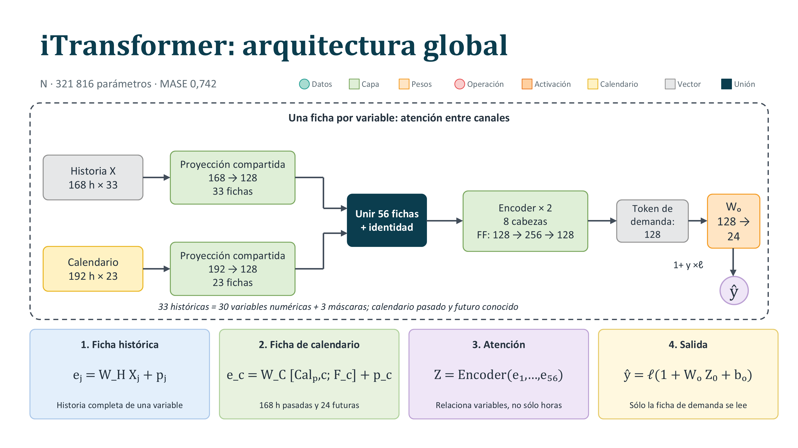
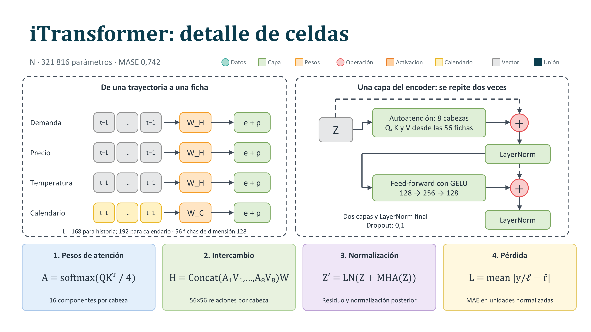

(e2-itransformer)=
# 10.10. iTransformer: atención entre variables

La {ref}`notación y las operaciones compartidas <fundamentos-arquitecturas>` definen los tensores, el nivel de demanda, la atención, las activaciones y la optimización.

## Arquitectura y fundamentos

iTransformer invierte el significado habitual de los tokens: cada ficha representa una variable completa, no una hora. Así, la atención relaciona la historia de demanda con la del precio, el clima y la hidrología. La estructura temporal de cada variable se comprime mediante una proyección lineal antes de la atención.

Las 30 variables históricas y tres indicadores producen 33 tokens de longitud 168. Cada variable de calendario usa historia y futuro conocidos, 192 valores, y genera uno de los 23 tokens adicionales. Las proyecciones llevan ambos tipos a dimensión 128 y se suman embeddings de identidad de variable. Las mismas matrices se comparten dentro de cada tipo; $p_j$ distingue los canales.

$$
e_j=W_Hx_{1:168,j}+p_j,\quad
e_c=W_C[F_{pas,c};F_{fut,c}]+p_c,\quad
Z=\operatorname{TransformerEncoder}([e_1,\ldots,e_{56}]).
$$ (eq-arquitecturas-itransformer-001)

El codificador tiene dos capas, ocho cabezas, red interna de ancho 256, GELU y normalización posterior con LayerNorm final. La atención compara consultas y claves de variables: $A=\operatorname{softmax}(QK^\top/\sqrt{d_k})$, seguido de $AV$. Solo el token de demanda alimenta la cabeza de 24 salidas: $\widehat{\mathbf y}=\ell_t[\mathbf1+W_OZ_0+b_O]$. La configuración 1 contiene 321.816 parámetros.

El calendario futuro puede relacionarse con las variables históricas dentro de la atención, pero no se crean tokens de clima o precio realizados durante el horizonte. La identidad por variable y la integración del calendario constituyen adaptaciones explícitas del experimento.

### Esquema global

[](../_static/arquitecturas_presentacion/itransformer_global.png)

Cada variable histórica se representa mediante un token de dimensión 128. El calendario aporta otros 23 tokens construidos con sus 168 horas pasadas y 24 futuras. Dos capas de atención relacionan los 56 tokens; la lectura del token de demanda genera el horizonte.

### Detalle de las operaciones

[](../_static/arquitecturas_presentacion/itransformer_detalle.png)

La proyección se comparte entre variables del mismo tipo, mientras una identidad aprendida distingue cada canal. Cada capa combina atención de ocho cabezas, conexiones residuales, normalización y una red interna de dimensión 256. La atención opera entre variables.

El {ref}`código de exportación de los esquemas <exportacion-esquemas>` forma parte del preprocesamiento compartido.

### Código de la arquitectura

```{literalinclude} ../_static/codigo_e2/itransformer_red.py
:language: python
:linenos:
```

<!-- diseno-entrenamiento:inicio -->

## Diseño de entrenamiento y prueba

(diseno-entrenamiento-itransformer)=

### Selección en validación

Se evaluaron **20 configuraciones** y 5 llegaron a la comparación de selección. La **configuración 1** obtuvo el menor MASE de validación (0,5604) sobre 2018–2021. La configuración fijada para prueba es **1**, con 5 semillas.

#### Configuración conservada
| Parámetro | Valor |
|---|---|
| Dimensión interna | 128 |
| Capas | 2 |
| Cabezas | 8 |
| Dropout | 0,1 |
| Tasa de aprendizaje | 0,001 |
| Decaimiento de pesos | 0,0001 |
| Lote de ajuste | 64 |

#### Etapas del entrenamiento y prueba

| Etapa | Especificación |
|---|---|
| Filtro inicial | 20 configuraciones; semilla 43; validación 2018 |
| Confirmación y criterio | Cinco finalistas; semilla 43; evaluación adicional 2019–2021; media de los cuatro años 2018–2021. Menor MASE medio de validación; cada año tiene el mismo peso. |
| Ajuste final | 2000-01-09 00:00:00-05:00 a 2019-10-20 00:00:00-05:00 |
| Parada interna final | 2019-10-21 00:00:00-05:00 a 2021-12-31 00:00:00-05:00 |
| Prueba | 2022-01-01 a 2025-12-31; 1.461 orígenes diarios |
| Semillas finales | 1000, 1001, 1002, 1003, 1004 |
| Historia y horizonte | 168 y 24 horas, respectivamente |
| Pérdida y optimizador | MAE de demanda dividida por el nivel histórico; AdamW |
| Épocas y parada | Máximo 200; mínimo 10; paciencia efectiva 6; restauración del menor valor interno |
| Tasa de aprendizaje | ReduceLROnPlateau: factor 0,5; paciencia 2 |
| Lotes | Ajuste: 64; evaluación de prueba: hasta 256 orígenes por lote |
| Épocas ejecutadas | 24–38; épocas de los checkpoints: 30, 18, 32, 29, 23 |


#### Configuraciones evaluadas en desarrollo
El filtro y la selección corresponden a periodos y cantidades de repeticiones distintos. El guion identifica las configuraciones que no avanzaron a confirmación; no representa un resultado nulo.
| Configuración | Hiperparámetros | MASE del filtro | MASE de validación | Estado |
|---|---|---:|---:|---|
| **1** | Dimensión interna: 128; Capas: 2; Cabezas: 8; Dropout: 0,1; Tasa de aprendizaje: 0,001; Decaimiento de pesos: 0,0001; Lote de ajuste: 64 | 0,4112 | 0,5604 | **Seleccionada para prueba** |
| 10 | Dimensión interna: 64; Capas: 2; Cabezas: 4; Dropout: 0,1; Tasa de aprendizaje: 0,001; Decaimiento de pesos: 0,0001; Lote de ajuste: 64 | 0,4954 | 0,5687 | Finalista |
| 12 | Dimensión interna: 512; Capas: 3; Cabezas: 8; Dropout: 0,1; Tasa de aprendizaje: 0,0003; Decaimiento de pesos: 0,0001; Lote de ajuste: 64 | 0,4786 | 0,5726 | Finalista |
| 13 | Dimensión interna: 512; Capas: 2; Cabezas: 8; Dropout: 0,2; Tasa de aprendizaje: 0,0003; Decaimiento de pesos: 0,001; Lote de ajuste: 64 | 0,4876 | 0,6118 | Finalista |
| 6 | Dimensión interna: 256; Capas: 2; Cabezas: 8; Dropout: 0,1; Tasa de aprendizaje: 0,0003; Decaimiento de pesos: 0,0001; Lote de ajuste: 64 | 0,4849 | 0,6243 | Finalista |
| 11 | Dimensión interna: 512; Capas: 2; Cabezas: 8; Dropout: 0,1; Tasa de aprendizaje: 0,0001; Decaimiento de pesos: 0,0001; Lote de ajuste: 32 | 0,5374 | — | Filtro inicial |
| 16 | Dimensión interna: 128; Capas: 4; Cabezas: 8; Dropout: 0,2; Tasa de aprendizaje: 0,001; Decaimiento de pesos: 0,0001; Lote de ajuste: 64 | 0,5517 | — | Filtro inicial |
| 19 | Dimensión interna: 256; Capas: 2; Cabezas: 8; Dropout: 0,3; Tasa de aprendizaje: 0,001; Decaimiento de pesos: 0,001; Lote de ajuste: 128 | 0,5615 | — | Filtro inicial |
| 14 | Dimensión interna: 512; Capas: 4; Cabezas: 8; Dropout: 0,2; Tasa de aprendizaje: 0,0001; Decaimiento de pesos: 0,0001; Lote de ajuste: 32 | 0,5950 | — | Filtro inicial |
| 2 | Dimensión interna: 128; Capas: 2; Cabezas: 8; Dropout: 0,1; Tasa de aprendizaje: 0,0003; Decaimiento de pesos: 0,0001; Lote de ajuste: 64 | 0,6242 | — | Filtro inicial |
| 17 | Dimensión interna: 64; Capas: 3; Cabezas: 4; Dropout: 0,2; Tasa de aprendizaje: 0,0003; Decaimiento de pesos: 0,0001; Lote de ajuste: 32 | 0,6541 | — | Filtro inicial |
| 15 | Dimensión interna: 256; Capas: 4; Cabezas: 8; Dropout: 0,1; Tasa de aprendizaje: 0,0003; Decaimiento de pesos: 0,0001; Lote de ajuste: 64 | 0,6671 | — | Filtro inicial |
| 5 | Dimensión interna: 128; Capas: 3; Cabezas: 8; Dropout: 0,2; Tasa de aprendizaje: 0,001; Decaimiento de pesos: 0,001; Lote de ajuste: 128 | 0,6823 | — | Filtro inicial |
| 4 | Dimensión interna: 128; Capas: 3; Cabezas: 8; Dropout: 0,1; Tasa de aprendizaje: 0,0003; Decaimiento de pesos: 0,0001; Lote de ajuste: 64 | 0,6931 | — | Filtro inicial |
| 8 | Dimensión interna: 256; Capas: 3; Cabezas: 8; Dropout: 0,1; Tasa de aprendizaje: 0,0001; Decaimiento de pesos: 0,0001; Lote de ajuste: 32 | 0,6958 | — | Filtro inicial |
| 20 | Dimensión interna: 128; Capas: 2; Cabezas: 8; Dropout: 0,1; Tasa de aprendizaje: 0,0001; Decaimiento de pesos: 0,0001; Lote de ajuste: 32 | 0,6977 | — | Filtro inicial |
| 3 | Dimensión interna: 128; Capas: 2; Cabezas: 8; Dropout: 0,2; Tasa de aprendizaje: 0,001; Decaimiento de pesos: 0,001; Lote de ajuste: 128 | 0,6986 | — | Filtro inicial |
| 18 | Dimensión interna: 64; Capas: 2; Cabezas: 4; Dropout: 0,3; Tasa de aprendizaje: 0,001; Decaimiento de pesos: 0,001; Lote de ajuste: 128 | 0,7017 | — | Filtro inicial |
| 7 | Dimensión interna: 256; Capas: 2; Cabezas: 8; Dropout: 0,2; Tasa de aprendizaje: 0,0001; Decaimiento de pesos: 0,001; Lote de ajuste: 32 | 0,7706 | — | Filtro inicial |
| 9 | Dimensión interna: 256; Capas: 3; Cabezas: 8; Dropout: 0,3; Tasa de aprendizaje: 0,0003; Decaimiento de pesos: 0,01; Lote de ajuste: 128 | 0,8223 | — | Filtro inicial |

[Resultados de desarrollo por año y semilla](../_static/resultados/diseno_entrenamiento/adj_modelo5_20261114_1327__N.csv) · [Configuraciones completas](../_static/resultados/diseno_entrenamiento/adj_modelo5_20261114_1327__N_configuraciones.csv).

<!-- diseno-entrenamiento:fin -->

## Pipeline de entrenamiento y prueba

<!-- entrenamiento-portable:inicio -->
### Comandos de entrenamiento y evaluación

Validación temporal de la configuración seleccionada:

```bash
python scripts/entrenar_arquitectura.py --modelo itransformer --anio 2021 --semilla 1000 --dispositivo auto --salida salidas/itransformer_validacion_1000
```

Comprobación funcional breve:

```bash
python scripts/entrenar_arquitectura.py --modelo itransformer --smoke --dispositivo cpu --salida salidas/itransformer_funcional
```

Evaluación final, con ajuste y parada anteriores a 2022:

```bash
python scripts/entrenar_arquitectura.py --modelo itransformer --fase prueba --allow-test --semilla 1000 --dispositivo auto --salida salidas/itransformer_prueba_1000
```

El código completo de preparación, optimización, guardado y restauración está en el {ref}`pipeline ejecutable compartido <entrenamiento-portable>`. Cada salida debe ser una carpeta nueva.
<!-- entrenamiento-portable:fin -->

El pipeline fija el plan y las huellas de entrada, genera ventanas cronológicas, ajusta las transformaciones por pliegue y evalúa 20 candidatos en 2018. Confirma cinco finalistas en 2019–2021, selecciona por MASE medio y reajusta con cinco semillas finales usando la reserva interna anterior a 2022. La lectura de la prueba solo ocurre después de cerrar la selección. El libro muestra las implementaciones y no llama al entrenamiento.

### Datos, referencias y escaladores por pliegue

```{literalinclude} ../_static/codigo_e2/Modelo5_iTransformer/src/entrenamiento/datos.py
:language: python
:linenos:
```

### Bucle de ajuste y predicción

```{literalinclude} ../_static/codigo_e2/Modelo5_iTransformer/src/entrenamiento/motor.py
:language: python
:linenos:
```

### Búsqueda, confirmación y evaluación final

```{literalinclude} ../_static/codigo_e2/Modelo5_iTransformer/src/entrenamiento/protocolo.py
:language: python
:linenos:
```

### Ejecución

El {ref}`pipeline común <entrenamiento-portable>` utiliza las fuentes de esta ficha y la configuración seleccionada. Los siguientes comandos ejecutan el ajuste y la evaluación.

La configuración exacta del paquete se conserva a continuación. Identifica variantes, candidatos, semillas, parada y presupuesto; se mantiene separada de las métricas calculadas a partir de artefactos.

```{literalinclude} ../_static/codigo_e2/Modelo5_iTransformer/config/modelo.json
:language: json
```


## Evaluación

Los resultados de esta familia se integran en la {ref}`evaluación estadística conjunta <evaluacion-e2>`, con métricas por semilla, horizonte y origen. La comparación distingue las entradas demanda/calendario de las entradas numéricas ampliadas y el aporte de texto oficial.

## Fuentes

[Liu et al., iTransformer](https://arxiv.org/abs/2310.06625). La descripción corresponde a la implementación del experimento; las adaptaciones se identifican en el texto.
