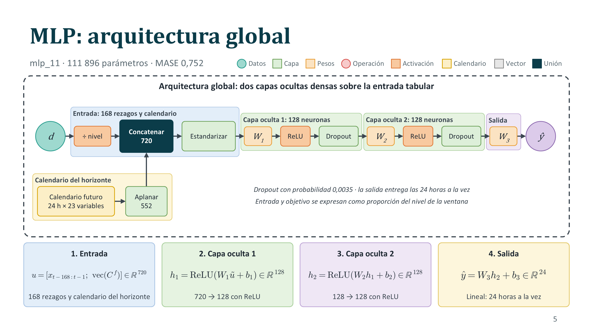

(e2-mlp)=
# 10.3. MLP: perceptrón multicapa

La {ref}`notación y las operaciones compartidas <fundamentos-arquitecturas>` definen los tensores, el nivel de demanda, la atención, las activaciones y la optimización.

## Arquitectura y fundamentos

El MLP trata la historia y el calendario como un vector. A diferencia de una regresión, sus capas pueden combinar no linealmente una hora pasada con un festivo o una estación del año. La posición temporal se conserva por el orden fijo de los rezagos; la red no tiene memoria recurrente ni un filtro compartido entre horas.

Los 168 valores de demanda normalizados por el nivel y los $24\times23=552$ valores de calendario futuro forman un vector de 720 atributos. Después de estandarizarlo con entrenamiento, se aplican dos capas de 128 unidades, ReLU y dropout. La salida lineal produce simultáneamente 24 razones de demanda respecto del nivel de la ventana.

$$
h^{(j)}=D_{p}\!\left[\max(0,W_jh^{(j-1)}+b_j)\right],\quad j=1,2,
\qquad \widehat{\mathbf y}=\ell_t(W_3h^{(2)}+b_3).
$$ (eq-arquitecturas-mlp-001)

$D_p$ apaga aleatoriamente unidades durante entrenamiento y se desactiva en evaluación. La tasa seleccionada es aproximadamente 0,00355. Las matrices tienen dimensiones $128\times720$, $128\times128$ y $24\times128$, para 111.896 parámetros. La red aprende qué combinaciones de rezagos son útiles, pero su aplanamiento exige parámetros separados para patrones desplazados en el tiempo.

La pérdida de ajuste es Huber normalizada con transición 0,05: es cuadrática cerca de cero y lineal para errores grandes. AdamW añade decaimiento de pesos de aproximadamente 0,000383; la tasa inicial es 0,00469. El mínimo de la pérdida de parada interna determina los pesos restaurados; el MAE/MASE de prueba se calcula después en kWh.

### Esquema global

[](../_static/arquitecturas_presentacion/mlp_global.png)

Los 168 rezagos y el calendario futuro forman 720 atributos. Dos capas de 128 neuronas combinan esas entradas antes de producir simultáneamente las 24 horas.

### Detalle de las operaciones

[](../_static/arquitecturas_presentacion/mlp_detalle.png)

Cada neurona aplica una combinación afín, ReLU y dropout durante el ajuste. La pérdida Huber se calcula en unidades normalizadas; el dropout se desactiva en evaluación.

El {ref}`código de exportación de los esquemas <exportacion-esquemas>` forma parte del preprocesamiento compartido.

### Código de la arquitectura

```{literalinclude} ../_static/codigo_e2/mlp_red.py
:language: python
:linenos:
```

<!-- diseno-entrenamiento:inicio -->

## Diseño de entrenamiento y prueba

(diseno-entrenamiento-mlp)=

### Selección en validación

Se evaluaron **20 configuraciones** y 3 llegaron a la comparación de selección. La **configuración mlp_11** obtuvo el menor MASE de validación (0,5335) sobre 2018–2021. La configuración fijada para prueba es **mlp_11**, con 5 semillas.

#### Configuración conservada
| Parámetro | Valor |
|---|---|
| Capas | 2 |
| Unidades | 128 |
| Dropout | 0,00354591 |
| Decaimiento de pesos | 0,000382722 |
| Lote de ajuste | 64 |
| Tasa de aprendizaje | 0,00468963 |
| Plan de tasa | plateau |
| Pérdida | huber |

#### Etapas del entrenamiento y prueba

| Etapa | Especificación |
|---|---|
| Filtro inicial | 20 configuraciones; semilla 42; validación 2019; máximo 30 épocas |
| Confirmación y criterio | 3 finalistas; semillas 43 y 44; años 2018–2021; máximo 60 épocas. Menor MASE medio de validación; cada año tiene el mismo peso. |
| Ajuste final | 2000–2021, excluida la reserva interna de parada |
| Parada interna final | Último 10 % de orígenes anteriores a 2022; purga de 24 horas |
| Prueba | 2022-01-01 a 2025-12-31; 1.461 orígenes diarios |
| Semillas finales | 1000, 1001, 1002, 1003, 1004 |
| Historia y horizonte | 168 y 24 horas, respectivamente |
| Pérdida y optimizador | Huber normalizada; transición 0,05; AdamW |
| Épocas y parada | Máximo 60; mínimo 10; paciencia efectiva 6; restauración del menor valor interno |
| Tasa de aprendizaje | ReduceLROnPlateau: factor 0,5; paciencia 2 |
| Lotes | Ajuste: 64; evaluación de prueba: hasta 4096 orígenes por lote |
| Épocas ejecutadas | 19–26; épocas de los checkpoints: 24, 24, 20, 13, 20 |


#### Configuraciones evaluadas en desarrollo
El filtro y la selección corresponden a periodos y cantidades de repeticiones distintos. El guion identifica las configuraciones que no avanzaron a confirmación; no representa un resultado nulo.
| Configuración | Hiperparámetros | MASE del filtro | MASE de validación | Estado |
|---|---|---:|---:|---|
| **mlp_11** | Capas: 2; Unidades: 128; Dropout: 0,00354591; Decaimiento de pesos: 0,000382722; Lote de ajuste: 64; Tasa de aprendizaje: 0,00468963; Plan de tasa: plateau; Pérdida: huber | 0,4538 | 0,5335 | **Seleccionada para prueba** |
| mlp_15 | Capas: 3; Unidades: 512; Dropout: 0,031359; Decaimiento de pesos: 0,00200425; Lote de ajuste: 64; Tasa de aprendizaje: 0,000562722; Plan de tasa: none; Pérdida: huber | 0,5437 | 0,6960 | Finalista |
| mlp_08 | Capas: 1; Unidades: 256; Dropout: 0,130049; Decaimiento de pesos: 0,00228837; Lote de ajuste: 128; Tasa de aprendizaje: 0,00105142; Plan de tasa: cosine; Pérdida: huber | 0,5584 | 0,7593 | Finalista |
| mlp_18 | Capas: 3; Unidades: 512; Dropout: 0,316068; Decaimiento de pesos: 0,0017422; Lote de ajuste: 64; Tasa de aprendizaje: 0,00122275; Plan de tasa: cosine; Pérdida: huber | 0,6135 | — | Filtro inicial |
| mlp_02 | Capas: 1; Unidades: 512; Dropout: 0,2046; Decaimiento de pesos: 0,000157897; Lote de ajuste: 32; Tasa de aprendizaje: 0,00321385; Plan de tasa: none; Pérdida: huber | 0,6785 | — | Filtro inicial |
| mlp_04 | Capas: 3; Unidades: 64; Dropout: 0,131157; Decaimiento de pesos: 0,00100336; Lote de ajuste: 32; Tasa de aprendizaje: 0,000934075; Plan de tasa: none; Pérdida: mse | 0,7089 | — | Filtro inicial |
| mlp_10 | Capas: 2; Unidades: 64; Dropout: 0,0407763; Decaimiento de pesos: 0,00263577; Lote de ajuste: 128; Tasa de aprendizaje: 0,00566336; Plan de tasa: plateau; Pérdida: mse | 0,7370 | — | Filtro inicial |
| mlp_19 | Capas: 3; Unidades: 512; Dropout: 0,121608; Decaimiento de pesos: 1,06529e-05; Lote de ajuste: 64; Tasa de aprendizaje: 0,000327798; Plan de tasa: none; Pérdida: huber | 0,7744 | — | Filtro inicial |
| mlp_06 | Capas: 2; Unidades: 256; Dropout: 0,0579328; Decaimiento de pesos: 0,00031186; Lote de ajuste: 64; Tasa de aprendizaje: 0,0016827; Plan de tasa: plateau; Pérdida: huber | 0,8200 | — | Filtro inicial |
| mlp_16 | Capas: 1; Unidades: 256; Dropout: 0,0892859; Decaimiento de pesos: 3,84614e-05; Lote de ajuste: 128; Tasa de aprendizaje: 0,000334957; Plan de tasa: none; Pérdida: mae | 0,9424 | — | Filtro inicial |
| mlp_20 | Capas: 1; Unidades: 256; Dropout: 0,0643366; Decaimiento de pesos: 3,19856e-05; Lote de ajuste: 32; Tasa de aprendizaje: 0,00213781; Plan de tasa: cosine; Pérdida: mae | 0,9508 | — | Filtro inicial |
| mlp_07 | Capas: 2; Unidades: 64; Dropout: 0,264295; Decaimiento de pesos: 6,87612e-05; Lote de ajuste: 64; Tasa de aprendizaje: 0,00191715; Plan de tasa: none; Pérdida: huber | 1,0136 | — | Filtro inicial |
| mlp_17 | Capas: 2; Unidades: 64; Dropout: 0,31658; Decaimiento de pesos: 3,32428e-05; Lote de ajuste: 32; Tasa de aprendizaje: 0,0020311; Plan de tasa: plateau; Pérdida: mse | 1,1431 | — | Filtro inicial |
| mlp_13 | Capas: 2; Unidades: 512; Dropout: 0,211358; Decaimiento de pesos: 0,000228039; Lote de ajuste: 256; Tasa de aprendizaje: 0,0022229; Plan de tasa: none; Pérdida: mae | 1,4103 | — | Filtro inicial |
| mlp_14 | Capas: 3; Unidades: 512; Dropout: 0,44276; Decaimiento de pesos: 0,000437947; Lote de ajuste: 64; Tasa de aprendizaje: 0,00344377; Plan de tasa: none; Pérdida: huber | 1,4901 | — | Filtro inicial |
| mlp_03 | Capas: 3; Unidades: 128; Dropout: 0,394214; Decaimiento de pesos: 1,63222e-05; Lote de ajuste: 32; Tasa de aprendizaje: 0,000185389; Plan de tasa: cosine; Pérdida: mae | 1,7031 | — | Filtro inicial |
| mlp_09 | Capas: 1; Unidades: 64; Dropout: 0,409813; Decaimiento de pesos: 0,000540938; Lote de ajuste: 256; Tasa de aprendizaje: 0,000241675; Plan de tasa: plateau; Pérdida: mae | 1,7155 | — | Filtro inicial |
| mlp_05 | Capas: 3; Unidades: 512; Dropout: 0,362395; Decaimiento de pesos: 0,000146187; Lote de ajuste: 256; Tasa de aprendizaje: 0,000209558; Plan de tasa: none; Pérdida: mse | 2,5418 | — | Filtro inicial |
| mlp_01 | Capas: 2; Unidades: 256; Dropout: 0,475232; Decaimiento de pesos: 3,77258e-06; Lote de ajuste: 256; Tasa de aprendizaje: 0,0004204; Plan de tasa: plateau; Pérdida: huber | 2,5686 | — | Filtro inicial |
| mlp_12 | Capas: 2; Unidades: 64; Dropout: 0,319666; Decaimiento de pesos: 0,00166043; Lote de ajuste: 256; Tasa de aprendizaje: 0,000200009; Plan de tasa: plateau; Pérdida: mse | 2,5792 | — | Filtro inicial |

[Resultados de desarrollo por año y semilla](../_static/resultados/diseno_entrenamiento/mlp.csv) · [Configuraciones completas](../_static/resultados/diseno_entrenamiento/mlp_configuraciones.csv).

<!-- diseno-entrenamiento:fin -->

## Pipeline de entrenamiento y prueba

<!-- entrenamiento-portable:inicio -->
### Comandos de entrenamiento y evaluación

Validación temporal de la configuración seleccionada:

```bash
python scripts/entrenar_arquitectura.py --modelo mlp --anio 2021 --semilla 1000 --dispositivo auto --salida salidas/mlp_validacion_1000
```

Comprobación funcional breve:

```bash
python scripts/entrenar_arquitectura.py --modelo mlp --smoke --dispositivo cpu --salida salidas/mlp_funcional
```

Evaluación final, con ajuste y parada anteriores a 2022:

```bash
python scripts/entrenar_arquitectura.py --modelo mlp --fase prueba --allow-test --semilla 1000 --dispositivo auto --salida salidas/mlp_prueba_1000
```

El código completo de preparación, optimización, guardado y restauración está en el {ref}`pipeline ejecutable compartido <entrenamiento-portable>`. Cada salida debe ser una carpeta nueva.
<!-- entrenamiento-portable:fin -->

La configuración utilizada por esta familia es:

```json
{
  "id": "mlp_11",
  "ventana": 168,
  "params": {
    "capas": 2,
    "unidades": 128,
    "dropout": 0.0035459143015831307,
    "weight_decay": 0.0003827221364333344,
    "batch_size": 64,
    "lr": 0.004689628419943547,
    "scheduler": "plateau",
    "perdida": "huber",
    "paciencia": 8
  }
}
```

El procedimiento separa ajuste, parada interna y evaluación externa, estima las transformaciones únicamente en ajuste y restaura el mínimo de parada. La función admite validación o prueba con autorización explícita y conserva las salidas en una carpeta nueva. Los bloques siguientes documentan el código; construir el libro no ejecuta entrenamientos.

### Escalado por pliegue y optimización

```{literalinclude} ../_static/codigo_e2/base/src/demanda/reentrenamiento_v3.py
:language: python
:linenos:
```


El siguiente bloque vincula las implementaciones mostradas y permite seleccionar CPU o GPU sin funciones exclusivas del sistema operativo. La inicialización del dispositivo se conserva en resolver_dispositivo.

```python
from pathlib import Path
import json,sys
import numpy as np
import pandas as pd

def ejecutar_configuracion(raiz, familia, semilla=1000, dispositivo='auto',
                          fase='validacion', anio=2021, permitir_prueba=False,
                          salida=None):
    raiz=Path(raiz).resolve()
    procedencia=json.loads((raiz/'results/jbook/modelos_actualizados.json').read_text())
    fuentes=raiz/'results/repositorio'/procedencia['commit']
    sys.path.insert(0,str(fuentes/'src'))
    from demanda import modelos_base as M, particion as P
    from demanda import reentrenamiento_v3 as motor
    from demanda.variantes_v4 import Secuencial as Recurrente
    from demanda.metricas import evaluar
    import torch
    registro=json.loads((fuentes/'results/consolidado/modelos.json').read_text())
    config=registro[familia]['configuracion']
    panel=pd.read_parquet(raiz/'data/processed/panel_horario.parquet')
    variables=json.loads((fuentes/'data/processed/feature_registry.json').read_text())
    cfg=M.ConfigDatos(ventana=config['ventana'])
    if fase=='prueba':
        if not permitir_prueba:raise PermissionError('La prueba requiere acceso explícito')
        tr,es=P.pretest(panel.index,ventana=cfg.ventana)
        ev=P.origenes(panel.index,'test',ventana=cfg.ventana,allow_test=True)
    else:
        fold=P.folds_forward_chaining(panel.index,[anio],ventana=cfg.ventana)[0]
        tr,es,ev=fold['tr'],fold['es'],fold['val']
    datos=motor.DatosFold(panel,variables,cfg,tr,secuencial=familia in ('lstm','cnn1d'))
    train,stop,evaluacion=[datos.conjunto_pos(p) for p in [tr,es,ev]]
    assert train.origen.max()+pd.Timedelta(hours=23)<stop.origen.min()
    assert stop.origen.max()+pd.Timedelta(hours=23)<evaluacion.origen.min()
    assert pd.Timestamp(datos.auditoria['fin_ajuste'])<stop.origen.min()
    fabrica=motor.Secuencial
    try:
        if familia=='lstm':motor.Secuencial=Recurrente
        modelo=motor.Entrenador(familia)
        info=modelo.ajustar(train,stop,datos,config['params'],semilla,
                           M.Opciones(max_epocas=60,dispositivo=dispositivo,hilos=2))
    finally:
        motor.Secuencial=fabrica
    pred=datos.invertir(modelo.predecir(evaluacion),evaluacion)
    metricas=evaluar(evaluacion.y,pred,datos.escala_mase)
    if salida is not None:
        destino=Path(salida)/familia/str(semilla)/str(anio if fase=='validacion' else fase)
        destino.mkdir(parents=True,exist_ok=False)
        escala=datos.escaladores()
        torch.save({'state_dict':{k:v.detach().cpu() for k,v in modelo.red.state_dict().items()},
                    'modelo':familia,'params':config['params'],'escaladores':escala},
                    destino/'modelo.pt')
        np.savez_compressed(destino/'predicciones.npz',y=evaluacion.y,yhat=pred,
                            origen=evaluacion.origen.as_unit('ns').asi8)
        for nombre,objeto in [('escaladores',escala),('historia',info['historia']),
                              ('metricas',metricas)]:
            (destino/(nombre+'.json')).write_text(json.dumps(objeto,ensure_ascii=False,
                                                indent=2,default=str),encoding='utf-8')
    return modelo,datos,evaluacion,pred,info,metricas

# Selección: comparar el MASE medio de confirmación, sin leer prueba.
# Piloto: repetir cada configuración seleccionada con semillas 100–104
# en los cuatro años externos. Final: semillas 1000–1004 con acceso explícito.
# El argumento salida conserva pesos, escaladores, curvas, métricas y predicciones.

```


Para esta página, `familia` toma el valor `mlp`. Las definiciones completas de datos y métricas se muestran en el {ref}`preprocesamiento compartido <fundamentos-arquitecturas>`; los cuerpos de las redes y del bucle de ajuste están visibles en esta página.

## Evaluación

Los resultados de esta familia se integran en la {ref}`evaluación estadística conjunta <evaluacion-e2>`, con métricas por semilla, horizonte y origen. La comparación distingue las entradas demanda/calendario de las entradas numéricas ampliadas y el aporte de texto oficial.

## Fuentes

La formulación y las dimensiones se verifican en las clases del código mostrado.. La descripción corresponde a la implementación del experimento; las adaptaciones se identifican en el texto.
