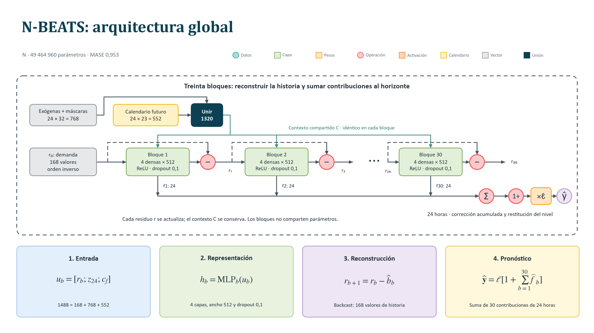

(e2-nbeats)=
# 10.14. N-BEATS: reconstrucción y pronóstico residual

## Arquitectura y fundamentos

N-BEATS divide el pronóstico en contribuciones sucesivas. Cada bloque recibe el residuo de la demanda, reconstruye una parte de la historia (*backcast*) y produce un pronóstico parcial. La reconstrucción se resta de la entrada del bloque siguiente; los pronósticos se suman. Así, los bloques pueden representar estructuras temporales complementarias sin una descomposición estacional impuesta.

La configuración seleccionada usa 30 bloques independientes, cada uno con cuatro capas densas de 512 unidades, ReLU y dropout 0,1. El residuo contiene las 168 horas de demanda en orden inverso. Cada bloque incorpora además las últimas 24 horas de las 29 covariables y tres máscaras de ausencia, y las 23 variables de calendario para las 24 horas futuras: la entrada tiene dimensión $168+24\times32+24\times23=1488$.

$$u_b=[r_b,\operatorname{vec}(X_{exo,24}),\operatorname{vec}(C_f)],\quad
h_b=\operatorname{MLP}_b(u_b),\quad [\widehat b_b,\widehat f_b]=W_bh_b+a_b,$$
$$r_{b+1}=r_b-\widehat b_b,\qquad
\widehat{\mathbf y}=\ell_t\left(\mathbf1+\sum_{b=1}^{30}\widehat f_b\right).$$

La base genérica convierte directamente los coeficientes aprendidos en reconstrucción y pronóstico; no corresponde a las bases interpretables de tendencia y estacionalidad de otra variante de N-BEATS. Las covariables se mantienen en todos los bloques y solo se actualiza el residuo de demanda. El modelo contiene 49.464.960 parámetros. Su coste denso crece aproximadamente como $O(B[d_{in}w+3w^2+w(L+H)])$, con $B=30$ bloques y ancho $w=512$.

La arquitectura sigue el mecanismo de doble residuo de [Oreshkin et al., N-BEATS, ICLR 2020](https://arxiv.org/abs/1905.10437), ampliado con las covariables numéricas y el calendario del proyecto.

## Esquema global

[](../_static/arquitecturas_presentacion/nbeats_global.png)

Los bloques reducen sucesivamente el residuo de la demanda y suman sus contribuciones a las siguientes 24 horas.

## Detalle de las operaciones

[](../_static/arquitecturas_presentacion/nbeats_detalle.png)

La reconstrucción de 168 valores y el pronóstico de 24 valores son dos salidas del mismo bloque; solo la reconstrucción modifica la entrada del siguiente.

El {ref}`código de generación de estos esquemas <esquemas-top10-detallados>` conserva sus dimensiones y conexiones.


## Código de la arquitectura

```{literalinclude} ../_static/codigo_e2/nbeats_red.py
:language: python
:linenos:
```

## Pipeline de entrenamiento y prueba

<!-- entrenamiento-portable:inicio -->
### Comandos de entrenamiento y evaluación

Validación temporal de la configuración seleccionada:

```bash
python scripts/entrenar_arquitectura.py --modelo nbeats --anio 2021 --semilla 1000 --dispositivo auto --salida salidas/nbeats_validacion_1000
```

Comprobación funcional breve:

```bash
python scripts/entrenar_arquitectura.py --modelo nbeats --smoke --dispositivo cpu --salida salidas/nbeats_funcional
```

Evaluación final, con ajuste y parada anteriores a 2022:

```bash
python scripts/entrenar_arquitectura.py --modelo nbeats --fase prueba --allow-test --semilla 1000 --dispositivo auto --salida salidas/nbeats_prueba_1000
```

El código completo de preparación, optimización, guardado y restauración está en el {ref}`pipeline ejecutable compartido <entrenamiento-portable>`. Cada salida debe ser una carpeta nueva.
<!-- entrenamiento-portable:fin -->

Se comparan 20 configuraciones en 2018; cinco finalistas se evalúan en 2019–2021 y se selecciona la menor media de los cuatro años. El ajuste final utiliza cinco semillas (1000–1004), máximo de 200 épocas, mínimo de 10 y paciencia de 6. El checkpoint se restaura en el mínimo de parada interna. La reserva contiene 803 orígenes de 2019-10-21 a 2021-12-31; la prueba comprende 1.461 orígenes de 2022–2025. Las imputaciones y escalas se ajustan con el tramo de entrenamiento. Precio, hidrología y clima se usan como historia con sus rezagos de disponibilidad.

### Preparación de datos

```{literalinclude} ../_static/codigo_e2/top10_adicionales/src/entrenamiento/datos.py
:language: python
:linenos:
```

### Selección y ajuste con parada temprana

```{literalinclude} ../_static/codigo_e2/top10_adicionales/src/entrenamiento/protocolo_e2.py
:language: python
:pyobject: modelo_estandar
:linenos:
```

```{literalinclude} ../_static/codigo_e2/top10_adicionales/src/entrenamiento/protocolo.py
:language: python
:pyobject: corrida
:linenos:
```

### Optimización y restauración del checkpoint

```{literalinclude} ../_static/codigo_e2/top10_adicionales/src/entrenamiento/motor.py
:language: python
:pyobject: entrenar
:linenos:
```

### Prueba por origen con pesos congelados

El siguiente código restaura la configuración y los escaladores del checkpoint y obtiene las métricas sin modificar los pesos. TimesNet se evalúa con lote uno.

```{literalinclude} ../_static/codigo_e2/top10_adicionales/pipeline_prueba.py
:language: python
:linenos:
```

Los resultados, curvas de cinco semillas, métricas por horizonte y comparaciones están en la {ref}`evaluación integrada <evaluacion-e2>`.
