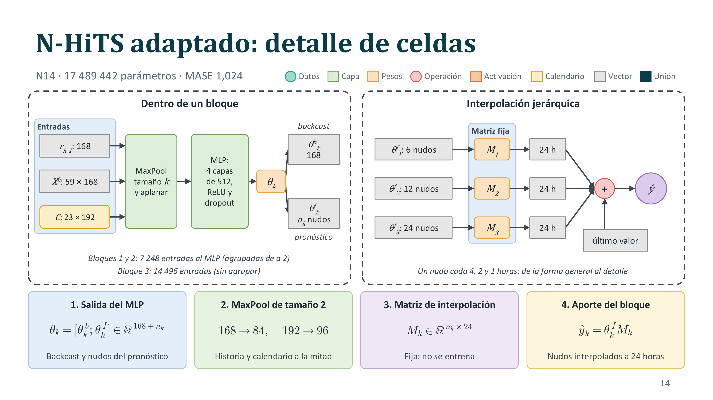

(e2-nhits)=
# 10.7. N-HiTS: interpolación jerárquica residual

La {ref}`notación y las operaciones compartidas <fundamentos-arquitecturas>` definen los tensores, el nivel de demanda, la atención, las activaciones y la optimización.

## Arquitectura y fundamentos

N-HiTS construye el pronóstico por contribuciones de distinta resolución. Un bloque explica una parte de la historia y propone una parte de la salida; el siguiente trabaja con el residuo que queda. La interpolación permite que un bloque describa el horizonte con pocos nodos, mientras otro añade variaciones más finas.

La implementación tiene tres bloques oficiales de N-HiTS con MLP de ancho 512, agrupamientos temporales 2, 2 y 1 y factores de reducción de salida 4, 2 y 1. Para 24 horas se predicen respectivamente 6, 12 y 24 nodos. Una matriz fija realiza interpolación lineal equivalente a `interpolate(..., align_corners=False)`. Cada bloque usa la historia residual, 59 exógenas históricas —29 variables distintas de demanda y 30 máscaras— y las 23 variables de calendario conocidas.

$$\theta_b=f_b(\operatorname{pool}_b(r_b),X_{exo},F),\quad
\widehat b_b=\theta_b^{back},\quad \widehat f_b=I_b\theta_b^{for},\qquad
r_{b+1}=r_b-\widehat b_b.$$

El pronóstico normalizado empieza en el último valor de demanda de la ventana y suma $\sum_b\widehat f_b$. El *backcast* reconstruye historia; no es una etiqueta futura ni una segunda serie objetivo. El modelo devuelve $\widehat{\mathbf y}=\ell_t\widehat{\mathbf r}$. Su configuración seleccionada N14 contiene 17.489.442 parámetros. Este tamaño se explica por las entradas multivariadas aplanadas de los bloques y no implica, por sí mismo, mayor capacidad predictiva efectiva.

El modelo reutiliza el preparador y el optimizador numérico de PatchTST, pero la red es diferente y no incorpora su lectura afín. Se conserva el procesamiento multiescala, el esquema residual y la interpolación. Las fuentes, licencia y revisión de NeuralForecast acompañan al código.

### Esquema global

[](../_static/arquitecturas_presentacion/nhits_global.png)

Los tres bloques explican progresivamente la historia y suman contribuciones al pronóstico. Las salidas interpoladas de 6, 12 y 24 nudos se añaden al último nivel observado.

### Detalle de las operaciones

[](../_static/arquitecturas_presentacion/nhits_detalle.png)

Cada bloque agrupa historia y exógenas, calcula coeficientes con un MLP y separa backcast y pronóstico. El backcast se resta de la historia; la interpolación fija lleva los nudos a las 24 horas del horizonte.

El {ref}`código de exportación de los esquemas <exportacion-esquemas>` forma parte del preprocesamiento compartido.

### Código de la arquitectura

```{literalinclude} ../_static/codigo_e2/nhits_red.py
:language: python
:linenos:
```

## Pipeline de entrenamiento y prueba

La preparación conserva 30 variables históricas, 23 de calendario y 30 máscaras. Se usan las mismas ventanas para ajuste, parada y prueba, con imputaciones y escalas estimadas solo en ajuste. El motor recibe el dispositivo explícitamente, guarda el mínimo de parada interna y convierte la salida normalizada a kWh. El código de la arquitectura incluye el motor para PatchTST; N-HiTS comparte ese motor sin compartir su red.

### Preparación, ajuste y predicción numérica

```{literalinclude} ../_static/codigo_e2/numerico_repositorio/src/demanda/patchtst_numerico.py
:language: python
:linenos:
```

### Bloque N-HiTS e interpolación

```{literalinclude} ../_static/codigo_e2/numerico_repositorio/src/demanda/vendor/nhits/core.py
:language: python
:linenos:
```

### Selección, piloto, ajuste final y prueba

```{literalinclude} ../_static/codigo_e2/numerico_repositorio/scripts/entrenar_nhits_numerico.py
:language: python
:linenos:
```

El orquestador preservado utiliza bloqueo `fcntl` y exige GPU en su entrada principal. El siguiente adaptador conserva red, configuración, preparación, parada y predicción, y permite escoger CPU o GPU sin ese controlador de Linux. Su inclusión documental no ejecuta un nuevo ajuste.

### Pipeline explícito compatible con Windows y Linux

```{literalinclude} ../_static/codigo_e2/pipeline_ampliado_portable.py
:language: python
:linenos:
```


## Evaluación

Los resultados de esta familia se integran en la {ref}`evaluación estadística conjunta <evaluacion-e2>`, con métricas por semilla, horizonte y origen. La comparación distingue las entradas demanda/calendario de las entradas numéricas ampliadas y el aporte de texto oficial.

## Fuentes

[Challu et al., N-HiTS](https://ojs.aaai.org/index.php/AAAI/article/view/25854). La descripción corresponde a la implementación del experimento; las adaptaciones se identifican en el texto.
