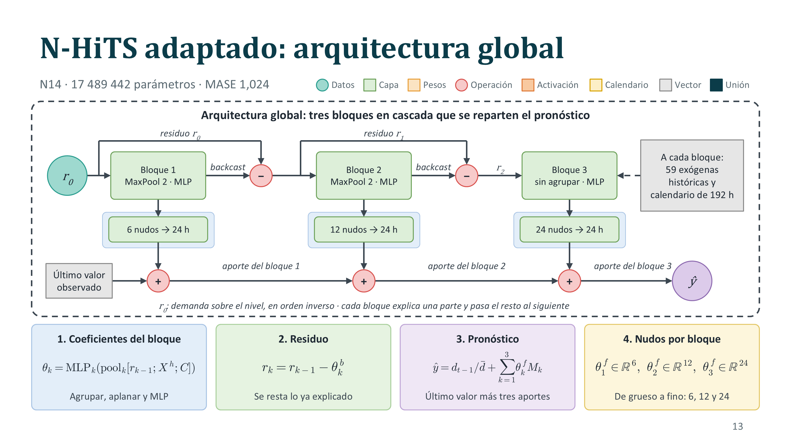

(e2-nhits)=
# 10.7. N-HiTS: interpolación jerárquica residual

La {ref}`notación y las operaciones compartidas <fundamentos-arquitecturas>` definen los tensores, el nivel de demanda, la atención, las activaciones y la optimización.

## Arquitectura y fundamentos

N-HiTS construye el pronóstico por contribuciones de distinta resolución. Un bloque explica una parte de la historia y propone una parte de la salida; el siguiente trabaja con el residuo que queda. La interpolación permite que un bloque describa el horizonte con pocos nodos, mientras otro añade variaciones más finas.

La implementación tiene tres bloques oficiales de N-HiTS con MLP de ancho 512, agrupamientos temporales 2, 2 y 1 y factores de reducción de salida 4, 2 y 1. Para 24 horas se predicen respectivamente 6, 12 y 24 nodos. Una matriz fija realiza interpolación lineal equivalente a `interpolate(..., align_corners=False)`. Cada bloque usa la historia residual, 59 exógenas históricas —29 variables distintas de demanda y 30 máscaras— y las 23 variables de calendario conocidas.

$$
\theta_b=f_b(\operatorname{pool}_b(r_b),X_{exo},F),\quad
\widehat b_b=\theta_b^{back},\quad \widehat f_b=I_b\theta_b^{for},\qquad
r_{b+1}=r_b-\widehat b_b.
$$ (eq-arquitecturas-nhits-001)

El pronóstico normalizado empieza en el último valor de demanda de la ventana y suma $\sum_b\widehat f_b$. El *backcast* reconstruye historia; no es una etiqueta futura ni una segunda serie objetivo. El modelo devuelve $\widehat{\mathbf y}=\ell_t\widehat{\mathbf r}$. Su configuración seleccionada N14 contiene 17.489.442 parámetros. Este tamaño se explica por las entradas multivariadas aplanadas de los bloques y no implica, por sí mismo, mayor capacidad predictiva efectiva.

El modelo reutiliza el preparador y el optimizador numérico de PatchTST, pero la red es diferente y no incorpora su lectura afín. Se conserva el procesamiento multiescala, el esquema residual y la interpolación. Las fuentes, licencia y revisión de NeuralForecast acompañan al código.

### Esquema global

[](../_static/arquitecturas_presentacion/nhits_global.png)

Los tres bloques explican progresivamente la historia y suman contribuciones al pronóstico. Las salidas interpoladas de 6, 12 y 24 nudos se añaden al último nivel observado.

### Detalle de las operaciones

[](../_static/arquitecturas_presentacion/nhits_detalle.png)

Cada bloque agrupa historia y exógenas, calcula coeficientes con un MLP y separa backcast y pronóstico. El backcast se resta de la historia; la interpolación fija lleva los nudos a las 24 horas del horizonte.

El {ref}`código de exportación de los esquemas <exportacion-esquemas>` forma parte del preprocesamiento compartido.

### Código de la arquitectura

```{literalinclude} ../_static/codigo_e2/nhits_red.py
:language: python
:linenos:
```

<!-- diseno-entrenamiento:inicio -->

## Diseño de entrenamiento y prueba

(diseno-entrenamiento-nhits)=

### Selección en validación

Se evaluaron **20 configuraciones** y 5 llegaron a la comparación de selección. La **configuración N14** obtuvo el menor MASE de validación (0,9304) sobre 2019–2021. La configuración fijada para prueba es **N14**, con 5 semillas.

#### Configuración conservada
| Parámetro | Valor |
|---|---|
| Tasa de aprendizaje | 0,00010336 |
| Lote de ajuste | 64 |
| Dropout | 0,195608 |
| Decaimiento de pesos | 1,44162e-06 |

#### Etapas del entrenamiento y prueba

| Etapa | Especificación |
|---|---|
| Filtro inicial | 20 configuraciones; tres semillas; validación 2018 |
| Confirmación y criterio | Cinco finalistas; tres semillas; años 2019–2021; la puntuación de selección excluye el filtro de 2018. Menor MASE medio de validación; cada año tiene el mismo peso. |
| Ajuste final | 2000–2021, excluida la reserva interna de parada |
| Parada interna final | Último 10 % de orígenes anteriores a 2022; purga de 24 horas |
| Prueba | 2022-01-01 a 2025-12-31; 1.461 orígenes diarios |
| Semillas finales | 1000, 1001, 1002, 1003, 1004 |
| Historia y horizonte | 168 y 24 horas, respectivamente |
| Pérdida y optimizador | MAE de demanda dividida por el nivel histórico; AdamW |
| Épocas y parada | Máximo 200; mínimo 10; paciencia efectiva 10; restauración del menor valor interno |
| Tasa de aprendizaje | ReduceLROnPlateau: factor 0,5; paciencia 2 |
| Lotes | Ajuste: 64; evaluación de prueba: hasta 64 orígenes por lote |
| Épocas ejecutadas | 15–21; épocas de los checkpoints: 11, 6, 5, 5, 10 |


#### Configuraciones evaluadas en desarrollo
El filtro y la selección corresponden a periodos y cantidades de repeticiones distintos. El guion identifica las configuraciones que no avanzaron a confirmación; no representa un resultado nulo.
| Configuración | Hiperparámetros | MASE del filtro | MASE de validación | Estado |
|---|---|---:|---:|---|
| **N14** | Tasa de aprendizaje: 0,00010336; Lote de ajuste: 64; Dropout: 0,195608; Decaimiento de pesos: 1,44162e-06 | 0,6269 | 0,9304 | **Seleccionada para prueba** |
| N04 | Tasa de aprendizaje: 0,000103774; Lote de ajuste: 64; Dropout: 0,127354; Decaimiento de pesos: 3,94617e-06 | 0,6421 | 0,9332 | Finalista |
| N15 | Tasa de aprendizaje: 0,000263174; Lote de ajuste: 32; Dropout: 0,167637; Decaimiento de pesos: 0,000269924 | 0,6394 | 0,9541 | Finalista |
| N06 | Tasa de aprendizaje: 0,000100643; Lote de ajuste: 32; Dropout: 0,0786891; Decaimiento de pesos: 0,000922368 | 0,6548 | 0,9570 | Finalista |
| N13 | Tasa de aprendizaje: 0,000421486; Lote de ajuste: 32; Dropout: 0,116508; Decaimiento de pesos: 6,80881e-06 | 0,6605 | 0,9625 | Finalista |
| N11 | Tasa de aprendizaje: 0,000248237; Lote de ajuste: 64; Dropout: 0,0884637; Decaimiento de pesos: 5,74229e-06 | 0,6690 | — | Filtro inicial |
| N07 | Tasa de aprendizaje: 0,000197065; Lote de ajuste: 64; Dropout: 0,259409; Decaimiento de pesos: 4,70571e-05 | 0,6780 | — | Filtro inicial |
| N16 | Tasa de aprendizaje: 0,000964873; Lote de ajuste: 64; Dropout: 0,171782; Decaimiento de pesos: 2,72872e-06 | 0,7099 | — | Filtro inicial |
| N18 | Tasa de aprendizaje: 0,000459035; Lote de ajuste: 32; Dropout: 0,249701; Decaimiento de pesos: 7,78391e-06 | 0,7179 | — | Filtro inicial |
| N08 | Tasa de aprendizaje: 0,000400238; Lote de ajuste: 32; Dropout: 0,231424; Decaimiento de pesos: 8,06178e-05 | 0,7240 | — | Filtro inicial |
| N12 | Tasa de aprendizaje: 0,000179581; Lote de ajuste: 32; Dropout: 0,291245; Decaimiento de pesos: 8,83417e-06 | 0,7245 | — | Filtro inicial |
| N10 | Tasa de aprendizaje: 0,000758298; Lote de ajuste: 16; Dropout: 0,17722; Decaimiento de pesos: 1,28959e-06 | 0,7634 | — | Filtro inicial |
| N20 | Tasa de aprendizaje: 0,000878968; Lote de ajuste: 32; Dropout: 0,202249; Decaimiento de pesos: 2,63526e-06 | 0,7653 | — | Filtro inicial |
| N01 | Tasa de aprendizaje: 0,001; Lote de ajuste: 32; Dropout: 0,1; Decaimiento de pesos: 0,0001 | 0,7676 | — | Filtro inicial |
| N05 | Tasa de aprendizaje: 0,00196812; Lote de ajuste: 64; Dropout: 0,164915; Decaimiento de pesos: 2,14238e-05 | 0,8659 | — | Filtro inicial |
| N02 | Tasa de aprendizaje: 0,00252957; Lote de ajuste: 64; Dropout: 0,14839; Decaimiento de pesos: 6,08571e-06 | 0,8736 | — | Filtro inicial |
| N09 | Tasa de aprendizaje: 0,00230437; Lote de ajuste: 64; Dropout: 0,14619; Decaimiento de pesos: 0,000452441 | 0,8963 | — | Filtro inicial |
| N03 | Tasa de aprendizaje: 0,00122413; Lote de ajuste: 16; Dropout: 0,284497; Decaimiento de pesos: 0,00477104 | 1,0270 | — | Filtro inicial |
| N17 | Tasa de aprendizaje: 0,00226148; Lote de ajuste: 16; Dropout: 0,231026; Decaimiento de pesos: 1,16432e-06 | 1,4560 | — | Filtro inicial |
| N19 | Tasa de aprendizaje: 0,00230194; Lote de ajuste: 16; Dropout: 0,245892; Decaimiento de pesos: 4,57105e-06 | 1,7964 | — | Filtro inicial |

[Resultados de desarrollo por año y semilla](../_static/resultados/diseno_entrenamiento/repo_nhits_numerico_r1__N.csv) · [Configuraciones completas](../_static/resultados/diseno_entrenamiento/repo_nhits_numerico_r1__N_configuraciones.csv).

<!-- diseno-entrenamiento:fin -->

## Pipeline de entrenamiento y prueba

<!-- entrenamiento-portable:inicio -->
### Comandos de entrenamiento y evaluación

Validación temporal de la configuración seleccionada:

```bash
python scripts/entrenar_arquitectura.py --modelo nhits --anio 2021 --semilla 1000 --dispositivo auto --salida salidas/nhits_validacion_1000
```

Comprobación funcional breve:

```bash
python scripts/entrenar_arquitectura.py --modelo nhits --smoke --dispositivo cpu --salida salidas/nhits_funcional
```

Evaluación final, con ajuste y parada anteriores a 2022:

```bash
python scripts/entrenar_arquitectura.py --modelo nhits --fase prueba --allow-test --semilla 1000 --dispositivo auto --salida salidas/nhits_prueba_1000
```

El código completo de preparación, optimización, guardado y restauración está en el {ref}`pipeline ejecutable compartido <entrenamiento-portable>`. Cada salida debe ser una carpeta nueva.
<!-- entrenamiento-portable:fin -->

La preparación conserva 30 variables históricas, 23 de calendario y 30 máscaras. Se usan las mismas ventanas para ajuste, parada y prueba, con imputaciones y escalas estimadas solo en ajuste. El motor recibe el dispositivo explícitamente, guarda el mínimo de parada interna y convierte la salida normalizada a kWh. El código de la arquitectura incluye el motor para PatchTST; N-HiTS comparte ese motor sin compartir su red.

### Preparación, ajuste y predicción numérica

```{literalinclude} ../_static/codigo_e2/numerico_repositorio/src/demanda/patchtst_numerico.py
:language: python
:linenos:
```

### Bloque N-HiTS e interpolación

```{literalinclude} ../_static/codigo_e2/numerico_repositorio/src/demanda/vendor/nhits/core.py
:language: python
:linenos:
```

### Selección, piloto, ajuste final y prueba

```{literalinclude} ../_static/codigo_e2/numerico_repositorio/scripts/entrenar_nhits_numerico.py
:language: python
:linenos:
```

El orquestador preservado utiliza bloqueo `fcntl` y exige GPU en su entrada principal. El siguiente adaptador conserva red, configuración, preparación, parada y predicción, y permite escoger CPU o GPU sin ese controlador de Linux. Su inclusión documental no ejecuta un nuevo ajuste.

### Pipeline explícito compatible con Windows y Linux

```{literalinclude} ../_static/codigo_e2/pipeline_ampliado_portable.py
:language: python
:linenos:
```


## Evaluación

Los resultados de esta familia se integran en la {ref}`evaluación estadística conjunta <evaluacion-e2>`, con métricas por semilla, horizonte y origen. La comparación distingue las entradas demanda/calendario de las entradas numéricas ampliadas y el aporte de texto oficial.

## Fuentes

[Challu et al., N-HiTS](https://ojs.aaai.org/index.php/AAAI/article/view/25854). La descripción corresponde a la implementación del experimento; las adaptaciones se identifican en el texto.
