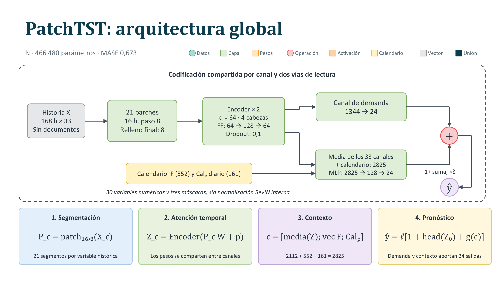
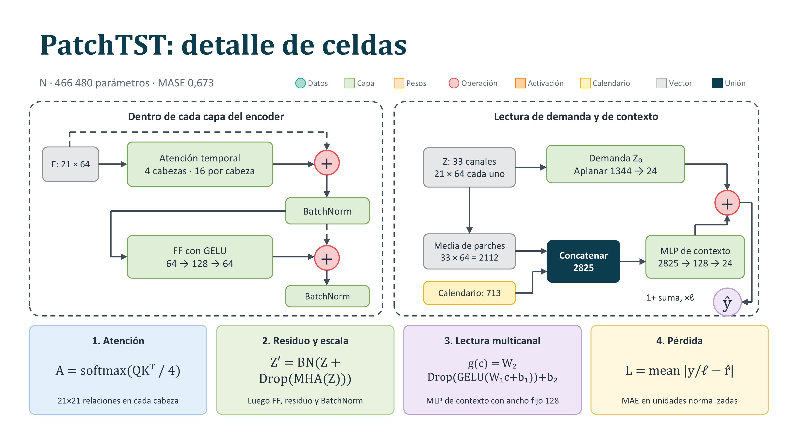

(e2-patchtst)=
# 10.6. PatchTST numérico

La {ref}`notación y las operaciones compartidas <fundamentos-arquitecturas>` definen los tensores, el nivel de demanda, la atención, las activaciones y la optimización.

## Arquitectura y fundamentos

PatchTST divide la historia de cada variable en segmentos superpuestos y procesa esos segmentos con atención. El codificador comparte sus pesos entre los canales; una lectura de contexto permite reunir la información de las covariables para pronosticar demanda.

La configuración seleccionada recibe 30 variables históricas y tres máscaras de ausencia: 33 canales. La ventana contiene 168 horas, con ocho copias adicionales del último valor para formar 21 parches de 16 horas y paso ocho. Cada parche se proyecta a dimensión 64 y recibe una posición aprendida. Se utilizan dos bloques de atención, cuatro cabezas, red interna de ancho 128, conexiones residuales, BatchNorm y dropout de 0,1.

$$
P_c=\operatorname{patch}_{16,8}(X_c),\quad E_c=P_cW_P+E_{pos},\qquad Z_c=\operatorname{Encoder}(E_c).
$$ (eq-arquitecturas-patchtst-001)

La salida combina dos vías. La primera aplana los 21 parches del canal de demanda: $21\times64=1.344$ atributos, proyectados a 24 correcciones. La segunda promedia los parches de cada canal y concatena $33\times64=2.112$ atributos con 552 de calendario futuro y 161 de calendario pasado agregado por día. El vector de contexto tiene 2.825 componentes y atraviesa un MLP $2825\rightarrow128\rightarrow24$, con GELU y dropout.

$$
c=[\operatorname{vec}(\overline Z);\operatorname{vec}(F);\operatorname{vec}(Cal_p)],\qquad
\widehat{\mathbf y}=\ell_t\left[\mathbf1+W_0\operatorname{vec}(Z_0)+b_0+g(c)\right].
$$ (eq-arquitecturas-patchtst-002)

La normalización externa se ajusta con entrenamiento y restituye la salida mediante el nivel de la ventana; este núcleo no aplica RevIN. La configuración 18 tiene 466.480 parámetros y se ajusta con MAE normalizado, AdamW y parada interna. Es el control numérico común de TaTS y fusión tardía, contabilizado una sola vez.

### Esquema global

[](../_static/arquitecturas_presentacion/patchtst_global.png)

Los 33 canales se dividen en 21 parches y pasan por dos capas de atención de dimensión64. La lectura del canal de demanda se suma a una lectura del contexto numérico y del calendario para producir las 24 salidas.

### Detalle de las operaciones

[](../_static/arquitecturas_presentacion/patchtst_detalle.png)

La atención de cuatro cabezas combina conexiones residuales, BatchNorm y una red interna de ancho128. Las dos lecturas reciben 1.344 atributos de demanda y 2.825 de contexto, respectivamente. Esta variante numérica no incorpora documentos.

El {ref}`código de exportación de los esquemas <exportacion-esquemas>` forma parte del preprocesamiento compartido.

### Código de la arquitectura

```{literalinclude} ../_static/codigo_e2/patchtst_red.py
:language: python
:linenos:
```

<!-- diseno-entrenamiento:inicio -->

## Diseño de entrenamiento y prueba

(diseno-entrenamiento-patchtst)=

### Selección en validación

Se evaluaron **20 configuraciones** y 5 llegaron a la comparación de selección. La **configuración 18** obtuvo el menor MASE de validación (0,5001) sobre 2018–2021. La configuración fijada para prueba es **18**, con 5 semillas.

#### Configuración conservada
| Parámetro | Valor |
|---|---|
| Núcleo | patchtst |
| Dimensión interna | 64 |
| Capas | 2 |
| Cabezas | 4 |
| Dropout | 0,1 |
| Tasa de aprendizaje | 0,001 |
| Decaimiento de pesos | 0,0001 |
| Lote de ajuste | 32 |

#### Etapas del entrenamiento y prueba

| Etapa | Especificación |
|---|---|
| Filtro inicial | 20 configuraciones; semilla 43; validación 2018 |
| Confirmación y criterio | Cinco finalistas; semilla 43; evaluación adicional 2019–2021; media de los cuatro años 2018–2021. Menor MASE medio de validación; cada año tiene el mismo peso. |
| Ajuste final | 2000-01-09 00:00:00-05:00 a 2019-10-20 00:00:00-05:00 |
| Parada interna final | 2019-10-21 00:00:00-05:00 a 2021-12-31 00:00:00-05:00 |
| Prueba | 2022-01-01 a 2025-12-31; 1.461 orígenes diarios |
| Semillas finales | 1000, 1001, 1002, 1003, 1004 |
| Historia y horizonte | 168 y 24 horas, respectivamente |
| Pérdida y optimizador | MAE de demanda dividida por el nivel histórico; AdamW |
| Épocas y parada | Máximo 200; mínimo 10; paciencia efectiva 6; restauración del menor valor interno |
| Tasa de aprendizaje | ReduceLROnPlateau: factor 0,5; paciencia 2 |
| Lotes | Ajuste: 32; evaluación de prueba: hasta 256 orígenes por lote |
| Épocas ejecutadas | 22–43; épocas de los checkpoints: 29, 16, 37, 31, 27 |


#### Configuraciones evaluadas en desarrollo
El filtro y la selección corresponden a periodos y cantidades de repeticiones distintos. El guion identifica las configuraciones que no avanzaron a confirmación; no representa un resultado nulo.
| Configuración | Hiperparámetros | MASE del filtro | MASE de validación | Estado |
|---|---|---:|---:|---|
| **18** | Núcleo: patchtst; Dimensión interna: 64; Capas: 2; Cabezas: 4; Dropout: 0,1; Tasa de aprendizaje: 0,001; Decaimiento de pesos: 0,0001; Lote de ajuste: 32 | 0,4093 | 0,5001 | **Seleccionada para prueba** |
| 12 | Núcleo: patchtst; Dimensión interna: 128; Capas: 3; Cabezas: 16; Dropout: 0,2; Tasa de aprendizaje: 0,0003; Decaimiento de pesos: 0,0001; Lote de ajuste: 64 | 0,4346 | 0,5279 | Finalista |
| 14 | Núcleo: patchtst; Dimensión interna: 128; Capas: 2; Cabezas: 8; Dropout: 0,2; Tasa de aprendizaje: 0,0003; Decaimiento de pesos: 0,0001; Lote de ajuste: 64 | 0,4494 | 0,5548 | Finalista |
| 1 | Núcleo: itransformer; Dimensión interna: 128; Capas: 2; Cabezas: 8; Dropout: 0,1; Tasa de aprendizaje: 0,001; Decaimiento de pesos: 0,0001; Lote de ajuste: 64 | 0,4112 | 0,5604 | Finalista |
| 13 | Núcleo: patchtst; Dimensión interna: 128; Capas: 3; Cabezas: 16; Dropout: 0,3; Tasa de aprendizaje: 0,001; Decaimiento de pesos: 0,001; Lote de ajuste: 128 | 0,4439 | 0,6136 | Finalista |
| 15 | Núcleo: patchtst; Dimensión interna: 64; Capas: 3; Cabezas: 4; Dropout: 0,2; Tasa de aprendizaje: 0,001; Decaimiento de pesos: 0,0001; Lote de ajuste: 64 | 0,4528 | — | Filtro inicial |
| 19 | Núcleo: patchtst; Dimensión interna: 128; Capas: 3; Cabezas: 16; Dropout: 0,1; Tasa de aprendizaje: 0,0001; Decaimiento de pesos: 0,01; Lote de ajuste: 32 | 0,4788 | — | Filtro inicial |
| 6 | Núcleo: itransformer; Dimensión interna: 256; Capas: 2; Cabezas: 8; Dropout: 0,1; Tasa de aprendizaje: 0,0003; Decaimiento de pesos: 0,0001; Lote de ajuste: 64 | 0,4849 | — | Filtro inicial |
| 10 | Núcleo: itransformer; Dimensión interna: 64; Capas: 2; Cabezas: 4; Dropout: 0,1; Tasa de aprendizaje: 0,001; Decaimiento de pesos: 0,0001; Lote de ajuste: 64 | 0,4954 | — | Filtro inicial |
| 11 | Núcleo: patchtst; Dimensión interna: 128; Capas: 3; Cabezas: 16; Dropout: 0,2; Tasa de aprendizaje: 0,0001; Decaimiento de pesos: 0,0001; Lote de ajuste: 128 | 0,5259 | — | Filtro inicial |
| 20 | Núcleo: patchtst; Dimensión interna: 16; Capas: 3; Cabezas: 4; Dropout: 0,3; Tasa de aprendizaje: 0,001; Decaimiento de pesos: 0,001; Lote de ajuste: 64 | 0,5298 | — | Filtro inicial |
| 16 | Núcleo: patchtst; Dimensión interna: 64; Capas: 3; Cabezas: 4; Dropout: 0,3; Tasa de aprendizaje: 0,0003; Decaimiento de pesos: 0,001; Lote de ajuste: 128 | 0,5578 | — | Filtro inicial |
| 17 | Núcleo: patchtst; Dimensión interna: 16; Capas: 3; Cabezas: 4; Dropout: 0,3; Tasa de aprendizaje: 0,0001; Decaimiento de pesos: 0,0001; Lote de ajuste: 128 | 0,6020 | — | Filtro inicial |
| 2 | Núcleo: itransformer; Dimensión interna: 128; Capas: 2; Cabezas: 8; Dropout: 0,1; Tasa de aprendizaje: 0,0003; Decaimiento de pesos: 0,0001; Lote de ajuste: 64 | 0,6242 | — | Filtro inicial |
| 5 | Núcleo: itransformer; Dimensión interna: 128; Capas: 3; Cabezas: 8; Dropout: 0,2; Tasa de aprendizaje: 0,001; Decaimiento de pesos: 0,001; Lote de ajuste: 128 | 0,6823 | — | Filtro inicial |
| 4 | Núcleo: itransformer; Dimensión interna: 128; Capas: 3; Cabezas: 8; Dropout: 0,1; Tasa de aprendizaje: 0,0003; Decaimiento de pesos: 0,0001; Lote de ajuste: 64 | 0,6931 | — | Filtro inicial |
| 8 | Núcleo: itransformer; Dimensión interna: 256; Capas: 3; Cabezas: 8; Dropout: 0,1; Tasa de aprendizaje: 0,0001; Decaimiento de pesos: 0,0001; Lote de ajuste: 32 | 0,6958 | — | Filtro inicial |
| 3 | Núcleo: itransformer; Dimensión interna: 128; Capas: 2; Cabezas: 8; Dropout: 0,2; Tasa de aprendizaje: 0,001; Decaimiento de pesos: 0,001; Lote de ajuste: 128 | 0,6986 | — | Filtro inicial |
| 7 | Núcleo: itransformer; Dimensión interna: 256; Capas: 2; Cabezas: 8; Dropout: 0,2; Tasa de aprendizaje: 0,0001; Decaimiento de pesos: 0,001; Lote de ajuste: 32 | 0,7706 | — | Filtro inicial |
| 9 | Núcleo: itransformer; Dimensión interna: 256; Capas: 3; Cabezas: 8; Dropout: 0,3; Tasa de aprendizaje: 0,0003; Decaimiento de pesos: 0,01; Lote de ajuste: 128 | 0,8223 | — | Filtro inicial |

[Resultados de desarrollo por año y semilla](../_static/resultados/diseno_entrenamiento/adj_modelo6_20261112_1035__N.csv) · [Configuraciones completas](../_static/resultados/diseno_entrenamiento/adj_modelo6_20261112_1035__N_configuraciones.csv).

<!-- diseno-entrenamiento:fin -->

## Pipeline de entrenamiento y prueba

<!-- entrenamiento-portable:inicio -->
### Comandos de entrenamiento y evaluación

Validación temporal de la configuración seleccionada:

```bash
python scripts/entrenar_arquitectura.py --modelo patchtst --anio 2021 --semilla 1000 --dispositivo auto --salida salidas/patchtst_validacion_1000
```

Comprobación funcional breve:

```bash
python scripts/entrenar_arquitectura.py --modelo patchtst --smoke --dispositivo cpu --salida salidas/patchtst_funcional
```

Evaluación final, con ajuste y parada anteriores a 2022:

```bash
python scripts/entrenar_arquitectura.py --modelo patchtst --fase prueba --allow-test --semilla 1000 --dispositivo auto --salida salidas/patchtst_prueba_1000
```

El código completo de preparación, optimización, guardado y restauración está en el {ref}`pipeline ejecutable compartido <entrenamiento-portable>`. Cada salida debe ser una carpeta nueva.
<!-- entrenamiento-portable:fin -->

El pipeline fija el plan y las huellas de entrada, genera ventanas cronológicas, ajusta las transformaciones por pliegue y evalúa 20 candidatos en 2018. Confirma cinco finalistas en 2019–2021, selecciona por MASE medio y reajusta con cinco semillas finales usando la reserva interna anterior a 2022. La lectura de la prueba solo ocurre después de cerrar la selección. El libro muestra las implementaciones y no llama al entrenamiento.

### Datos, referencias y escaladores por pliegue

```{literalinclude} ../_static/codigo_e2/Modelo6_TaTS/src/modelo6/datos.py
:language: python
:linenos:
```

### Bucle de ajuste y predicción

```{literalinclude} ../_static/codigo_e2/Modelo6_TaTS/src/modelo6/motor.py
:language: python
:linenos:
```

### Búsqueda, confirmación y evaluación final

```{literalinclude} ../_static/codigo_e2/Modelo6_TaTS/src/modelo6/protocolo.py
:language: python
:linenos:
```

### Ejecución

El {ref}`pipeline común <entrenamiento-portable>` utiliza las fuentes de esta ficha y la configuración seleccionada. Los siguientes comandos ejecutan el ajuste y la evaluación.

La configuración exacta del paquete se conserva a continuación. Identifica variantes, candidatos, semillas, parada y presupuesto; se mantiene separada de las métricas calculadas a partir de artefactos.

```{literalinclude} ../_static/codigo_e2/Modelo6_TaTS/config/modelo6.json
:language: json
```


## Evaluación

Los resultados de esta familia se integran en la {ref}`evaluación estadística conjunta <evaluacion-e2>`, con métricas por semilla, horizonte y origen. La comparación distingue las entradas demanda/calendario de las entradas numéricas ampliadas y el aporte de texto oficial.

## Fuentes

[Nie et al., PatchTST](https://arxiv.org/abs/2211.14730). La descripción corresponde a la implementación del experimento; las adaptaciones se identifican en el texto.
