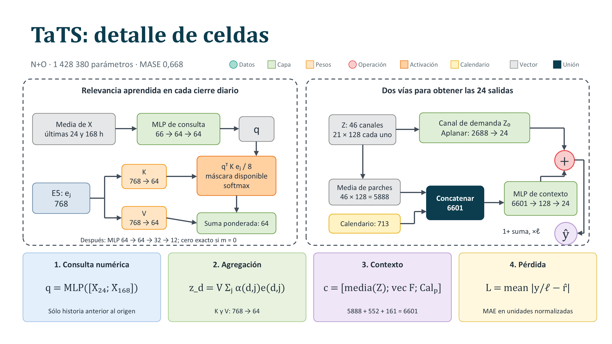

(e2-tats)=
# 10.11. TaTS: texto como variables temporales auxiliares

La {ref}`notación y las operaciones compartidas <fundamentos-arquitecturas>` definen los tensores, el nivel de demanda, la atención, las activaciones y la optimización.

## Arquitectura y fundamentos

TaTS convierte el texto en canales adicionales de una serie. En lugar de modificar el pronóstico al final, permite que el núcleo temporal procese conjuntamente la información numérica y una representación textual diaria. Los embeddings de documentos son constantes; la relevancia que los pondera se aprende con la pérdida de pronóstico.

Para cada uno de los siete cierres diarios de la historia se reúnen documentos oficiales disponibles en las 72 horas anteriores, hasta 64. La consulta $q_t$ se obtiene de los promedios numéricos de las últimas 24 y 168 horas. Cada embedding E5 $e_j\in\mathbb R^{768}$ recibe un peso:

$$
\alpha_{d,j}=\operatorname{softmax}_j\!\left(\frac{q_t^TK e_{d,j}}{\sqrt{64}}\right),\quad
z_d=\operatorname{MLP}_{64\rightarrow64\rightarrow32\rightarrow12}\!\left(\sum_j\alpha_{d,j}Ve_{d,j}\right).
$$ (eq-arquitecturas-tats-001)

La representación diaria y su indicador de presencia se repiten en las 24 horas del bloque y se concatenan a las entradas históricas. Sin documentos, ambos quedan en cero. Se conservan únicamente documentos habilitados al cierre correspondiente; la ventana textual no lee artículos futuros.

La variante oficial seleccionada utiliza PatchTST de dimensión 128, tres capas y 16 cabezas, con 21 parches por canal. Una cabeza lineal opera sobre los parches de demanda y otra MLP de contexto combina resúmenes de todos los canales y calendario. Esta segunda vía permite que el texto y las exógenas influyan en el objetivo aun con un codificador independiente por canal. El total es de 1.428.380 parámetros.

La configuración numérica seleccionada usa un núcleo más pequeño: dimensión 64, dos capas y cuatro cabezas. Por tanto, el contraste de resultados mide el procedimiento completo de selección con y sin texto, no un efecto puro de contenido con arquitectura idéntica. La agregación aprendida y la cabeza de contexto son adaptaciones al mecanismo de TaTS.

### Esquema global

[](../_static/arquitecturas_presentacion/tats_global.png)

El texto oficial se resume mediante relevancia aprendida en siete cierres diarios. Doce atributos y un indicador de presencia por día se repiten sobre las horas correspondientes y se añaden a los 33 canales numéricos. PatchTST procesa los 46 canales y combina la lectura de demanda con una lectura de contexto.

### Detalle de las operaciones

[](../_static/arquitecturas_presentacion/tats_detalle.png)

Los embeddings E5 permanecen congelados; las proyecciones de consulta, clave y valor aprenden a ponderar documentos disponibles. Las dos lecturas producen 24 correcciones: una utiliza el canal de demanda y otra reúne los demás canales con el calendario. Sin documentos, los canales textuales son cero.

El {ref}`código de exportación de los esquemas <exportacion-esquemas>` forma parte del preprocesamiento compartido.

### Código de la arquitectura

```{literalinclude} ../_static/codigo_e2/tats_red.py
:language: python
:linenos:
```

<!-- diseno-entrenamiento:inicio -->

## Diseño de entrenamiento y prueba

(diseno-entrenamiento-tats)=

### Selección en validación

Se evaluaron **20 configuraciones** y 5 llegaron a la comparación de selección. La **configuración 12** obtuvo el menor MASE de validación (0,5157) sobre 2018–2021. La configuración fijada para prueba es **12**, con 5 semillas.

#### Configuración conservada
| Parámetro | Valor |
|---|---|
| Núcleo | patchtst |
| Dimensión interna | 128 |
| Capas | 3 |
| Cabezas | 16 |
| Dropout | 0,2 |
| Tasa de aprendizaje | 0,0003 |
| Decaimiento de pesos | 0,0001 |
| Lote de ajuste | 64 |
| Dimensión textual | 12 |

#### Etapas del entrenamiento y prueba

| Etapa | Especificación |
|---|---|
| Filtro inicial | 20 configuraciones; semilla 43; validación 2018 |
| Confirmación y criterio | Cinco finalistas; semilla 43; evaluación adicional 2019–2021; media de los cuatro años 2018–2021. Menor MASE medio de validación; cada año tiene el mismo peso. Selección independiente del canal numérico y documental. |
| Ajuste final | 2000-01-09 00:00:00-05:00 a 2019-10-20 00:00:00-05:00 |
| Parada interna final | 2019-10-21 00:00:00-05:00 a 2021-12-31 00:00:00-05:00 |
| Prueba | 2022-01-01 a 2025-12-31; 1.461 orígenes diarios |
| Semillas finales | 1000, 1001, 1002, 1003, 1004 |
| Historia y horizonte | 168 y 24 horas, respectivamente |
| Pérdida y optimizador | MAE de demanda dividida por el nivel histórico; AdamW |
| Épocas y parada | Máximo 200; mínimo 10; paciencia efectiva 6; restauración del menor valor interno |
| Tasa de aprendizaje | ReduceLROnPlateau: factor 0,5; paciencia 2 |
| Lotes | Ajuste: 64; evaluación de prueba: hasta 256 orígenes por lote |
| Épocas ejecutadas | 23–47; épocas de los checkpoints: 32, 41, 27, 35, 17 |


#### Configuraciones evaluadas en desarrollo
El filtro y la selección corresponden a periodos y cantidades de repeticiones distintos. El guion identifica las configuraciones que no avanzaron a confirmación; no representa un resultado nulo.
| Configuración | Hiperparámetros | MASE del filtro | MASE de validación | Estado |
|---|---|---:|---:|---|
| **12** | Núcleo: patchtst; Dimensión interna: 128; Capas: 3; Cabezas: 16; Dropout: 0,2; Tasa de aprendizaje: 0,0003; Decaimiento de pesos: 0,0001; Lote de ajuste: 64; Dimensión textual: 12 | 0,4561 | 0,5157 | **Seleccionada para prueba** |
| 14 | Núcleo: patchtst; Dimensión interna: 128; Capas: 2; Cabezas: 8; Dropout: 0,2; Tasa de aprendizaje: 0,0003; Decaimiento de pesos: 0,0001; Lote de ajuste: 64; Dimensión textual: 24 | 0,4142 | 0,5200 | Finalista |
| 19 | Núcleo: patchtst; Dimensión interna: 128; Capas: 3; Cabezas: 16; Dropout: 0,1; Tasa de aprendizaje: 0,0001; Decaimiento de pesos: 0,01; Lote de ajuste: 32; Dimensión textual: 6 | 0,4098 | 0,5235 | Finalista |
| 18 | Núcleo: patchtst; Dimensión interna: 64; Capas: 2; Cabezas: 4; Dropout: 0,1; Tasa de aprendizaje: 0,001; Decaimiento de pesos: 0,0001; Lote de ajuste: 32; Dimensión textual: 24 | 0,4600 | 0,5281 | Finalista |
| 13 | Núcleo: patchtst; Dimensión interna: 128; Capas: 3; Cabezas: 16; Dropout: 0,3; Tasa de aprendizaje: 0,001; Decaimiento de pesos: 0,001; Lote de ajuste: 128; Dimensión textual: 6 | 0,4359 | 0,5392 | Finalista |
| 1 | Núcleo: itransformer; Dimensión interna: 128; Capas: 2; Cabezas: 8; Dropout: 0,1; Tasa de aprendizaje: 0,001; Decaimiento de pesos: 0,0001; Lote de ajuste: 64; Dimensión textual: 12 | 0,4623 | — | Filtro inicial |
| 6 | Núcleo: itransformer; Dimensión interna: 256; Capas: 2; Cabezas: 8; Dropout: 0,1; Tasa de aprendizaje: 0,0003; Decaimiento de pesos: 0,0001; Lote de ajuste: 64; Dimensión textual: 12 | 0,4773 | — | Filtro inicial |
| 3 | Núcleo: itransformer; Dimensión interna: 128; Capas: 2; Cabezas: 8; Dropout: 0,2; Tasa de aprendizaje: 0,001; Decaimiento de pesos: 0,001; Lote de ajuste: 128; Dimensión textual: 6 | 0,4806 | — | Filtro inicial |
| 11 | Núcleo: patchtst; Dimensión interna: 128; Capas: 3; Cabezas: 16; Dropout: 0,2; Tasa de aprendizaje: 0,0001; Decaimiento de pesos: 0,0001; Lote de ajuste: 128; Dimensión textual: 12 | 0,4847 | — | Filtro inicial |
| 10 | Núcleo: itransformer; Dimensión interna: 64; Capas: 2; Cabezas: 4; Dropout: 0,1; Tasa de aprendizaje: 0,001; Decaimiento de pesos: 0,0001; Lote de ajuste: 64; Dimensión textual: 12 | 0,5050 | — | Filtro inicial |
| 5 | Núcleo: itransformer; Dimensión interna: 128; Capas: 3; Cabezas: 8; Dropout: 0,2; Tasa de aprendizaje: 0,001; Decaimiento de pesos: 0,001; Lote de ajuste: 128; Dimensión textual: 12 | 0,5269 | — | Filtro inicial |
| 16 | Núcleo: patchtst; Dimensión interna: 64; Capas: 3; Cabezas: 4; Dropout: 0,3; Tasa de aprendizaje: 0,0003; Decaimiento de pesos: 0,001; Lote de ajuste: 128; Dimensión textual: 12 | 0,5317 | — | Filtro inicial |
| 8 | Núcleo: itransformer; Dimensión interna: 256; Capas: 3; Cabezas: 8; Dropout: 0,1; Tasa de aprendizaje: 0,0001; Decaimiento de pesos: 0,0001; Lote de ajuste: 32; Dimensión textual: 12 | 0,5413 | — | Filtro inicial |
| 4 | Núcleo: itransformer; Dimensión interna: 128; Capas: 3; Cabezas: 8; Dropout: 0,1; Tasa de aprendizaje: 0,0003; Decaimiento de pesos: 0,0001; Lote de ajuste: 64; Dimensión textual: 24 | 0,5419 | — | Filtro inicial |
| 20 | Núcleo: patchtst; Dimensión interna: 16; Capas: 3; Cabezas: 4; Dropout: 0,3; Tasa de aprendizaje: 0,001; Decaimiento de pesos: 0,001; Lote de ajuste: 64; Dimensión textual: 12 | 0,5420 | — | Filtro inicial |
| 2 | Núcleo: itransformer; Dimensión interna: 128; Capas: 2; Cabezas: 8; Dropout: 0,1; Tasa de aprendizaje: 0,0003; Decaimiento de pesos: 0,0001; Lote de ajuste: 64; Dimensión textual: 12 | 0,5566 | — | Filtro inicial |
| 7 | Núcleo: itransformer; Dimensión interna: 256; Capas: 2; Cabezas: 8; Dropout: 0,2; Tasa de aprendizaje: 0,0001; Decaimiento de pesos: 0,001; Lote de ajuste: 32; Dimensión textual: 24 | 0,5606 | — | Filtro inicial |
| 15 | Núcleo: patchtst; Dimensión interna: 64; Capas: 3; Cabezas: 4; Dropout: 0,2; Tasa de aprendizaje: 0,001; Decaimiento de pesos: 0,0001; Lote de ajuste: 64; Dimensión textual: 12 | 0,6007 | — | Filtro inicial |
| 9 | Núcleo: itransformer; Dimensión interna: 256; Capas: 3; Cabezas: 8; Dropout: 0,3; Tasa de aprendizaje: 0,0003; Decaimiento de pesos: 0,01; Lote de ajuste: 128; Dimensión textual: 6 | 0,6466 | — | Filtro inicial |
| 17 | Núcleo: patchtst; Dimensión interna: 16; Capas: 3; Cabezas: 4; Dropout: 0,3; Tasa de aprendizaje: 0,0001; Decaimiento de pesos: 0,0001; Lote de ajuste: 128; Dimensión textual: 12 | 0,7235 | — | Filtro inicial |

[Resultados de desarrollo por año y semilla](../_static/resultados/diseno_entrenamiento/adj_modelo6_20261112_1035__N+O.csv) · [Configuraciones completas](../_static/resultados/diseno_entrenamiento/adj_modelo6_20261112_1035__N+O_configuraciones.csv).

<!-- diseno-entrenamiento:fin -->

## Pipeline de entrenamiento y prueba

<!-- entrenamiento-portable:inicio -->
### Comandos de entrenamiento y evaluación

Validación temporal de la configuración seleccionada:

```bash
python scripts/entrenar_arquitectura.py --modelo tats --anio 2021 --semilla 1000 --dispositivo auto --salida salidas/tats_validacion_1000
```

Comprobación funcional breve:

```bash
python scripts/entrenar_arquitectura.py --modelo tats --smoke --dispositivo cpu --salida salidas/tats_funcional
```

Evaluación final, con ajuste y parada anteriores a 2022:

```bash
python scripts/entrenar_arquitectura.py --modelo tats --fase prueba --allow-test --semilla 1000 --dispositivo auto --salida salidas/tats_prueba_1000
```

El código completo de preparación, optimización, guardado y restauración está en el {ref}`pipeline ejecutable compartido <entrenamiento-portable>`. Cada salida debe ser una carpeta nueva.
<!-- entrenamiento-portable:fin -->

El pipeline fija el plan y las huellas de entrada, genera ventanas cronológicas, ajusta las transformaciones por pliegue y evalúa 20 candidatos en 2018. Confirma cinco finalistas en 2019–2021, selecciona por MASE medio y reajusta con cinco semillas finales usando la reserva interna anterior a 2022. La lectura de la prueba solo ocurre después de cerrar la selección. El libro muestra las implementaciones y no llama al entrenamiento.

### Datos, referencias y escaladores por pliegue

```{literalinclude} ../_static/codigo_e2/Modelo6_TaTS/src/modelo6/datos.py
:language: python
:linenos:
```

### Bucle de ajuste y predicción

```{literalinclude} ../_static/codigo_e2/Modelo6_TaTS/src/modelo6/motor.py
:language: python
:linenos:
```

### Búsqueda, confirmación y evaluación final

```{literalinclude} ../_static/codigo_e2/Modelo6_TaTS/src/modelo6/protocolo.py
:language: python
:linenos:
```

### Disponibilidad, embeddings y preparación del texto

```{literalinclude} ../_static/codigo_e2/Modelo6_TaTS/src/modelo6/texto.py
:language: python
:linenos:
```

### Ejecución

El {ref}`pipeline común <entrenamiento-portable>` utiliza las fuentes de esta ficha y la configuración seleccionada. Los siguientes comandos ejecutan el ajuste y la evaluación.

La configuración exacta del paquete se conserva a continuación. Identifica variantes, candidatos, semillas, parada y presupuesto; se mantiene separada de las métricas calculadas a partir de artefactos.

```{literalinclude} ../_static/codigo_e2/Modelo6_TaTS/config/modelo6.json
:language: json
```


## Evaluación

Los resultados de esta familia se integran en la {ref}`evaluación estadística conjunta <evaluacion-e2>`, con métricas por semilla, horizonte y origen. La comparación distingue las entradas demanda/calendario de las entradas numéricas ampliadas y el aporte de texto oficial.

## Fuentes

[Li et al., TaTS, versión 3](https://arxiv.org/html/2502.08942v3). La descripción corresponde a la implementación del experimento; las adaptaciones se identifican en el texto.
