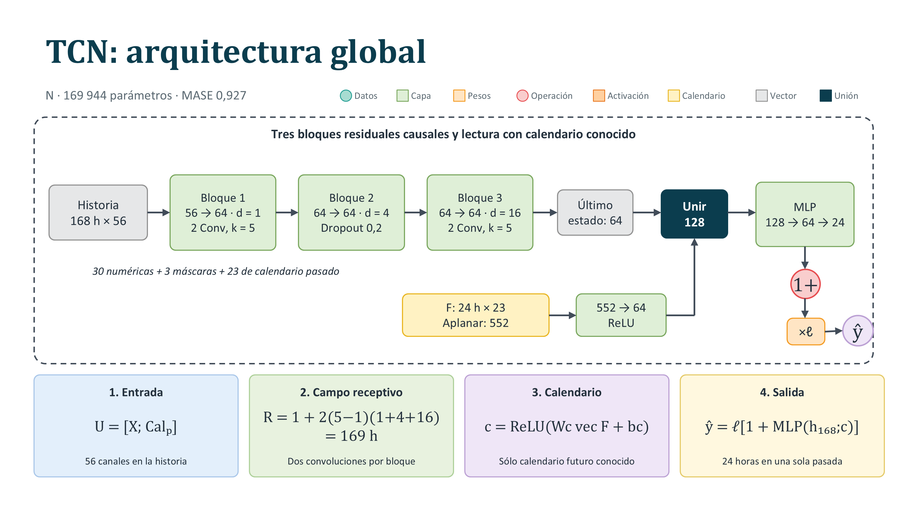
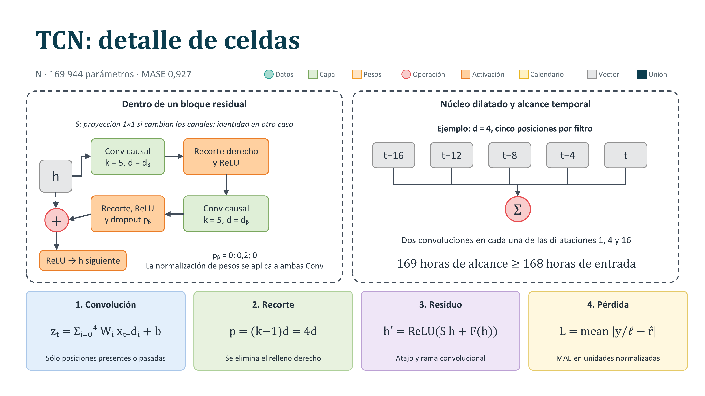

(e2-tcn)=
# 10.9. TCN: convoluciones causales dilatadas

La {ref}`notación y las operaciones compartidas <fundamentos-arquitecturas>` definen los tensores, el nivel de demanda, la atención, las activaciones y la optimización.

## Arquitectura y fundamentos

Una TCN aumenta su alcance temporal separando las posiciones que consulta cada filtro. Con dilatación cuatro, por ejemplo, un núcleo de cinco pesos lee posiciones separadas cuatro horas. El apilamiento permite integrar semanas de historia sin usar recurrencia. La causalidad se impone recortando el relleno derecho de cada convolución.

La red seleccionada usa tres bloques de 64 filtros, dilataciones 1, 4 y 16 y núcleo cinco. Cada bloque contiene dos convoluciones, normalización de pesos, ReLU y una conexión residual; una proyección $1\times1$ adapta el atajo si cambia el número de canales. El dropout de 0,2 está activo al final del bloque central, de acuerdo con el patrón (0,1,0).

$$
\operatorname{Conv}_{d}(x)_s=\sum_{i=0}^{k-1}W_i x_{s-di}+b,\qquad
h_{b+1}=\operatorname{ReLU}(S_bh_b+F_b(h_b)).
$$ (eq-arquitecturas-tcn-001)

Con dos convoluciones por bloque, el campo receptivo es $R=1+2(k-1)\sum_bd_b=169$ horas, suficiente para las 168 de entrada. El resultado depende de contar ambas convoluciones: una sola por bloque no cubriría la ventana. La representación de la última hora se concatena con una proyección del calendario futuro y una cabeza densa produce las 24 correcciones normalizadas. Hay 169.944 parámetros.

La implementación utiliza únicamente datos anteriores al origen en las convoluciones. El calendario futuro entra por una rama separada porque sí se conoce de antemano. La selección evaluó 20 candidatos; su alcance depende del espacio y del presupuesto de búsqueda descritos en el diseño experimental.

### Esquema global

[](../_static/arquitecturas_presentacion/tcn_global.png)

Los 56 canales históricos atraviesan tres bloques causales con dilataciones 1, 4 y 16. Su campo receptivo de 169 horas cubre la ventana de 168 horas; el último estado se combina con el calendario futuro para producir las 24 salidas.

### Detalle de las operaciones

[](../_static/arquitecturas_presentacion/tcn_detalle.png)

Cada bloque contiene dos convoluciones de cinco posiciones, recorte del relleno derecho y una conexión residual. El bloque central aplica dropout de 0,2; el atajo proyecta los canales cuando cambia su dimensión. La lectura combina 64 atributos temporales y 64 de calendario.

El {ref}`código de exportación de los esquemas <exportacion-esquemas>` forma parte del preprocesamiento compartido.

### Código de la arquitectura

```{literalinclude} ../_static/codigo_e2/tcn_red.py
:language: python
:linenos:
```

<!-- diseno-entrenamiento:inicio -->

## Diseño de entrenamiento y prueba

(diseno-entrenamiento-tcn)=

### Selección en validación

Se evaluaron **20 configuraciones** y 5 llegaron a la comparación de selección. La **configuración 7** obtuvo el menor MASE de validación (0,6354) sobre 2018–2021. La configuración fijada para prueba es **7**, con 5 semillas.

#### Configuración conservada
| Parámetro | Valor |
|---|---|
| Núcleo convolucional | 5 |
| Anchos | 64 × 64 × 64 |
| Patrón de dropout | 0 × 1 × 0 |
| Dropout | 0,2 |
| Tasa de aprendizaje | 0,001 |
| Decaimiento de pesos | 0,01 |
| Lote de ajuste | 64 |

#### Etapas del entrenamiento y prueba

| Etapa | Especificación |
|---|---|
| Filtro inicial | 20 configuraciones; semilla 43; validación 2018 |
| Confirmación y criterio | Cinco finalistas; semilla 43; evaluación adicional 2019–2021; media de los cuatro años 2018–2021. Menor MASE medio de validación; cada año tiene el mismo peso. |
| Ajuste final | 2000-01-09 00:00:00-05:00 a 2019-10-20 00:00:00-05:00 |
| Parada interna final | 2019-10-21 00:00:00-05:00 a 2021-12-31 00:00:00-05:00 |
| Prueba | 2022-01-01 a 2025-12-31; 1.461 orígenes diarios |
| Semillas finales | 1000, 1001, 1002, 1003, 1004 |
| Historia y horizonte | 168 y 24 horas, respectivamente |
| Pérdida y optimizador | MAE de demanda dividida por el nivel histórico; AdamW |
| Épocas y parada | Máximo 200; mínimo 10; paciencia efectiva 6; restauración del menor valor interno |
| Tasa de aprendizaje | ReduceLROnPlateau: factor 0,5; paciencia 2 |
| Lotes | Ajuste: 64; evaluación de prueba: hasta 256 orígenes por lote |
| Épocas ejecutadas | 15–41; épocas de los checkpoints: 13, 24, 23, 35, 9 |


#### Configuraciones evaluadas en desarrollo
El filtro y la selección corresponden a periodos y cantidades de repeticiones distintos. El guion identifica las configuraciones que no avanzaron a confirmación; no representa un resultado nulo.
| Configuración | Hiperparámetros | MASE del filtro | MASE de validación | Estado |
|---|---|---:|---:|---|
| **7** | Núcleo convolucional: 5; Anchos: [64, 64, 64]; Patrón de dropout: [0, 1, 0]; Dropout: 0,2; Tasa de aprendizaje: 0,001; Decaimiento de pesos: 0,01; Lote de ajuste: 64 | 0,4407 | 0,6354 | **Seleccionada para prueba** |
| 19 | Núcleo convolucional: 7; Anchos: [64, 64, 64]; Patrón de dropout: [0, 1, 0]; Dropout: 0,2; Tasa de aprendizaje: 0,001; Decaimiento de pesos: 0; Lote de ajuste: 32 | 0,4504 | 0,6396 | Finalista |
| 9 | Núcleo convolucional: 5; Anchos: [64, 64, 64]; Patrón de dropout: [0, 1, 0]; Dropout: 0,2; Tasa de aprendizaje: 0,001; Decaimiento de pesos: 0; Lote de ajuste: 32 | 0,4525 | 0,6467 | Finalista |
| 17 | Núcleo convolucional: 7; Anchos: [64, 64, 64]; Patrón de dropout: [0, 1, 0]; Dropout: 0,2; Tasa de aprendizaje: 0,001; Decaimiento de pesos: 0,01; Lote de ajuste: 64 | 0,4539 | 0,6620 | Finalista |
| 12 | Núcleo convolucional: 7; Anchos: [64, 64, 64]; Patrón de dropout: [0, 1, 0]; Dropout: 0,2; Tasa de aprendizaje: 0,0003; Decaimiento de pesos: 0,0001; Lote de ajuste: 64 | 0,4506 | 0,6718 | Finalista |
| 6 | Núcleo convolucional: 5; Anchos: [64, 64, 64]; Patrón de dropout: [0, 1, 0]; Dropout: 0,2; Tasa de aprendizaje: 0,0003; Decaimiento de pesos: 0,001; Lote de ajuste: 32 | 0,4599 | — | Filtro inicial |
| 18 | Núcleo convolucional: 7; Anchos: [64, 64, 64]; Patrón de dropout: [0, 1, 0]; Dropout: 0,2; Tasa de aprendizaje: 0,0003; Decaimiento de pesos: 0; Lote de ajuste: 64 | 0,4651 | — | Filtro inicial |
| 2 | Núcleo convolucional: 5; Anchos: [64, 64, 64]; Patrón de dropout: [0, 1, 0]; Dropout: 0,2; Tasa de aprendizaje: 0,0003; Decaimiento de pesos: 0,0001; Lote de ajuste: 64 | 0,4673 | — | Filtro inicial |
| 11 | Núcleo convolucional: 7; Anchos: [64, 64, 64]; Patrón de dropout: [0, 1, 0]; Dropout: 0,2; Tasa de aprendizaje: 0,001; Decaimiento de pesos: 0,0001; Lote de ajuste: 64 | 0,4674 | — | Filtro inicial |
| 8 | Núcleo convolucional: 5; Anchos: [64, 64, 64]; Patrón de dropout: [0, 1, 0]; Dropout: 0,2; Tasa de aprendizaje: 0,0003; Decaimiento de pesos: 0; Lote de ajuste: 64 | 0,4714 | — | Filtro inicial |
| 16 | Núcleo convolucional: 7; Anchos: [64, 64, 64]; Patrón de dropout: [0, 1, 0]; Dropout: 0,2; Tasa de aprendizaje: 0,0003; Decaimiento de pesos: 0,001; Lote de ajuste: 32 | 0,4762 | — | Filtro inicial |
| 4 | Núcleo convolucional: 5; Anchos: [64, 64, 64]; Patrón de dropout: [0, 1, 0]; Dropout: 0,2; Tasa de aprendizaje: 0,003; Decaimiento de pesos: 0,0001; Lote de ajuste: 128 | 0,4788 | — | Filtro inicial |
| 1 | Núcleo convolucional: 5; Anchos: [64, 64, 64]; Patrón de dropout: [0, 1, 0]; Dropout: 0,2; Tasa de aprendizaje: 0,001; Decaimiento de pesos: 0,0001; Lote de ajuste: 64 | 0,4828 | — | Filtro inicial |
| 5 | Núcleo convolucional: 5; Anchos: [64, 64, 64]; Patrón de dropout: [0, 1, 0]; Dropout: 0,2; Tasa de aprendizaje: 0,001; Decaimiento de pesos: 0,001; Lote de ajuste: 128 | 0,4868 | — | Filtro inicial |
| 20 | Núcleo convolucional: 7; Anchos: [64, 64, 64]; Patrón de dropout: [0, 1, 0]; Dropout: 0,2; Tasa de aprendizaje: 0,0001; Decaimiento de pesos: 0,001; Lote de ajuste: 64 | 0,5037 | — | Filtro inicial |
| 15 | Núcleo convolucional: 7; Anchos: [64, 64, 64]; Patrón de dropout: [0, 1, 0]; Dropout: 0,2; Tasa de aprendizaje: 0,001; Decaimiento de pesos: 0,001; Lote de ajuste: 128 | 0,5047 | — | Filtro inicial |
| 14 | Núcleo convolucional: 7; Anchos: [64, 64, 64]; Patrón de dropout: [0, 1, 0]; Dropout: 0,2; Tasa de aprendizaje: 0,003; Decaimiento de pesos: 0,0001; Lote de ajuste: 128 | 0,5094 | — | Filtro inicial |
| 13 | Núcleo convolucional: 7; Anchos: [64, 64, 64]; Patrón de dropout: [0, 1, 0]; Dropout: 0,2; Tasa de aprendizaje: 0,0001; Decaimiento de pesos: 0,0001; Lote de ajuste: 32 | 0,5168 | — | Filtro inicial |
| 10 | Núcleo convolucional: 5; Anchos: [64, 64, 64]; Patrón de dropout: [0, 1, 0]; Dropout: 0,2; Tasa de aprendizaje: 0,0001; Decaimiento de pesos: 0,001; Lote de ajuste: 64 | 0,5213 | — | Filtro inicial |
| 3 | Núcleo convolucional: 5; Anchos: [64, 64, 64]; Patrón de dropout: [0, 1, 0]; Dropout: 0,2; Tasa de aprendizaje: 0,0001; Decaimiento de pesos: 0,0001; Lote de ajuste: 32 | 0,5264 | — | Filtro inicial |

[Resultados de desarrollo por año y semilla](../_static/resultados/diseno_entrenamiento/adj_modelo4_20261114_1224__N.csv) · [Configuraciones completas](../_static/resultados/diseno_entrenamiento/adj_modelo4_20261114_1224__N_configuraciones.csv).

<!-- diseno-entrenamiento:fin -->

## Pipeline de entrenamiento y prueba

<!-- entrenamiento-portable:inicio -->
### Comandos de entrenamiento y evaluación

Validación temporal de la configuración seleccionada:

```bash
python scripts/entrenar_arquitectura.py --modelo tcn --anio 2021 --semilla 1000 --dispositivo auto --salida salidas/tcn_validacion_1000
```

Comprobación funcional breve:

```bash
python scripts/entrenar_arquitectura.py --modelo tcn --smoke --dispositivo cpu --salida salidas/tcn_funcional
```

Evaluación final, con ajuste y parada anteriores a 2022:

```bash
python scripts/entrenar_arquitectura.py --modelo tcn --fase prueba --allow-test --semilla 1000 --dispositivo auto --salida salidas/tcn_prueba_1000
```

El código completo de preparación, optimización, guardado y restauración está en el {ref}`pipeline ejecutable compartido <entrenamiento-portable>`. Cada salida debe ser una carpeta nueva.
<!-- entrenamiento-portable:fin -->

El pipeline fija el plan y las huellas de entrada, genera ventanas cronológicas, ajusta las transformaciones por pliegue y evalúa 20 candidatos en 2018. Confirma cinco finalistas en 2019–2021, selecciona por MASE medio y reajusta con cinco semillas finales usando la reserva interna anterior a 2022. La lectura de la prueba solo ocurre después de cerrar la selección. El libro muestra las implementaciones y no llama al entrenamiento.

### Datos, referencias y escaladores por pliegue

```{literalinclude} ../_static/codigo_e2/Modelo4_TCN/src/entrenamiento/datos.py
:language: python
:linenos:
```

### Bucle de ajuste y predicción

```{literalinclude} ../_static/codigo_e2/Modelo4_TCN/src/entrenamiento/motor.py
:language: python
:linenos:
```

### Búsqueda, confirmación y evaluación final

```{literalinclude} ../_static/codigo_e2/Modelo4_TCN/src/entrenamiento/protocolo.py
:language: python
:linenos:
```

### Ejecución

El {ref}`pipeline común <entrenamiento-portable>` utiliza las fuentes de esta ficha y la configuración seleccionada. Los siguientes comandos ejecutan el ajuste y la evaluación.

La configuración exacta del paquete se conserva a continuación. Identifica variantes, candidatos, semillas, parada y presupuesto; se mantiene separada de las métricas calculadas a partir de artefactos.

```{literalinclude} ../_static/codigo_e2/Modelo4_TCN/config/modelo.json
:language: json
```


## Evaluación

Los resultados de esta familia se integran en la {ref}`evaluación estadística conjunta <evaluacion-e2>`, con métricas por semilla, horizonte y origen. La comparación distingue las entradas demanda/calendario de las entradas numéricas ampliadas y el aporte de texto oficial.

## Fuentes

[Bai et al., convoluciones causales dilatadas](https://arxiv.org/abs/1803.01271). La descripción corresponde a la implementación del experimento; las adaptaciones se identifican en el texto.
