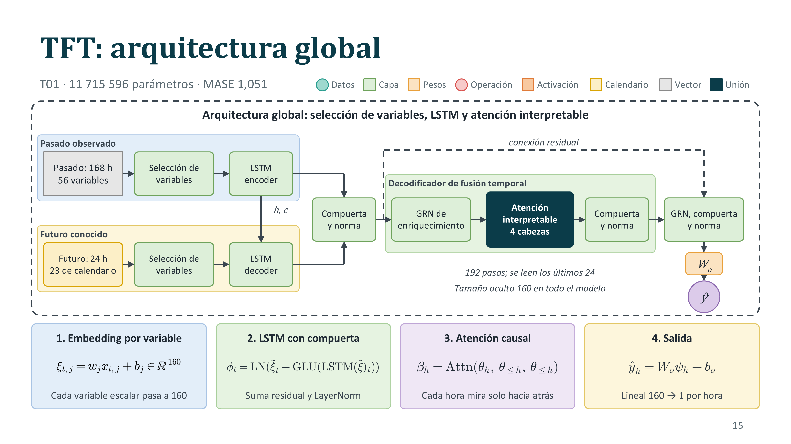
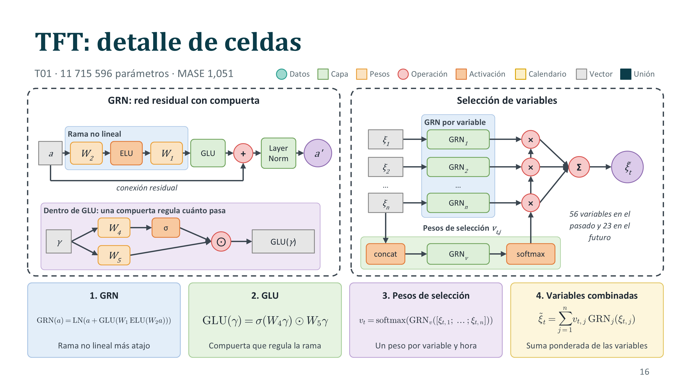

(e2-tft)=
# 10.8. TFT: selección de variables y atención interpretable

La {ref}`notación y las operaciones compartidas <fundamentos-arquitecturas>` definen los tensores, el nivel de demanda, la atención, las activaciones y la optimización.

## Arquitectura y fundamentos

TFT combina selección de variables, memoria recurrente y atención. Primero decide qué variables ponderar en cada hora; después resume la secuencia y permite que cada hora del horizonte consulte los pasos relevantes de la historia. Las compuertas residuales regulan cuánto de cada transformación se incorpora.

La configuración seleccionada tiene ancho 160 y cuatro cabezas. Recibe 56 variables pasadas: 30 históricas, tres indicadores de ausencia por bloque y 23 de calendario. El futuro contiene únicamente 23 variables de calendario. Cada variable continua tiene un embedding lineal y una GRN propia. Una segunda GRN produce pesos softmax $v_{s,j}$; su suma es uno y la representación seleccionada es $z_s=\sum_jv_{s,j}\operatorname{GRN}_j(e_{s,j})$.

Una GRN utiliza una transformación no lineal, una compuerta y un atajo:

$$
\operatorname{GRN}(a)=\operatorname{LayerNorm}\!\left(Sa+\operatorname{GLU}(W_1\operatorname{ELU}(W_2a+b_2)+b_1)\right),\quad
\operatorname{GLU}(u)=\sigma(W_gu+b_g)\odot(W_vu+b_v).
$$ (eq-arquitecturas-tft-001)

El codificador LSTM procesa las 168 horas y su estado inicializa al decodificador que recibe el calendario futuro. El enriquecimiento GRN precede a la atención interpretable: las cabezas comparten la proyección de valores y se promedian. La máscara impide que la consulta de la hora $h$ utilice representaciones del decodificador posteriores a ella. Las GRN por posición y las compuertas finales producen una salida escalar por hora. El total es de 11.715.596 parámetros.

Se omiten codificadores estáticos porque se estudia una sola serie. Se entrena un pronóstico puntual con MAE normalizado, no todos los cuantiles del artículo. Los pesos de selección describen el mecanismo del modelo; no son efectos causales de las variables. Esta documentación y los resultados usan la configuración TFT seleccionada del paquete, identificada por sus fuentes y checkpoints.

### Esquema global

[](../_static/arquitecturas_presentacion/tft_global.png)

La selección de variables transforma las 56 entradas históricas y las 23 de calendario futuro a representaciones de dimensión 160. La recurrencia, las compuertas y la atención de cuatro cabezas producen una salida por hora.

### Detalle de las operaciones

[](../_static/arquitecturas_presentacion/tft_detalle.png)

Las GRN combinan transformaciones no lineales con conexiones residuales y compuertas. La selección softmax pondera las representaciones de las variables en cada instante; esos pesos describen el mecanismo interno y no efectos causales.

El {ref}`código de exportación de los esquemas <exportacion-esquemas>` forma parte del preprocesamiento compartido.

### Código de la arquitectura

```{literalinclude} ../_static/codigo_e2/tft_red.py
:language: python
:linenos:
```

<!-- diseno-entrenamiento:inicio -->

## Diseño de entrenamiento y prueba

(diseno-entrenamiento-tft)=

### Selección en validación

Se evaluaron **20 configuraciones** y 5 llegaron a la comparación de selección. La **configuración 1** obtuvo el menor MASE de validación (0,7097) sobre 2018–2021. La configuración fijada para prueba es **1**, con 5 semillas.

#### Configuración conservada
| Parámetro | Valor |
|---|---|
| Dimensión interna | 160 |
| Cabezas | 4 |
| Dropout | 0,1 |
| Tasa de aprendizaje | 0,001 |
| Decaimiento de pesos | 0 |
| Lote de ajuste | 32 |

#### Etapas del entrenamiento y prueba

| Etapa | Especificación |
|---|---|
| Filtro inicial | 20 configuraciones; semilla 43; validación 2018 |
| Confirmación y criterio | Cinco finalistas; semilla 43; evaluación adicional 2019–2021; media de los cuatro años 2018–2021. Menor MASE medio de validación; cada año tiene el mismo peso. |
| Ajuste final | 2000-01-09 00:00:00-05:00 a 2019-10-20 00:00:00-05:00 |
| Parada interna final | 2019-10-21 00:00:00-05:00 a 2021-12-31 00:00:00-05:00 |
| Prueba | 2022-01-01 a 2025-12-31; 1.461 orígenes diarios |
| Semillas finales | 1000, 1001, 1002, 1003, 1004 |
| Historia y horizonte | 168 y 24 horas, respectivamente |
| Pérdida y optimizador | MAE de demanda dividida por el nivel histórico; AdamW |
| Épocas y parada | Máximo 200; mínimo 10; paciencia efectiva 6; restauración del menor valor interno |
| Tasa de aprendizaje | ReduceLROnPlateau: factor 0,5; paciencia 2 |
| Lotes | Ajuste: 32; evaluación de prueba: hasta 256 orígenes por lote |
| Épocas ejecutadas | 10–24; épocas de los checkpoints: 18, 5, 4, 15, 10 |


#### Configuraciones evaluadas en desarrollo
El filtro y la selección corresponden a periodos y cantidades de repeticiones distintos. El guion identifica las configuraciones que no avanzaron a confirmación; no representa un resultado nulo.
| Configuración | Hiperparámetros | MASE del filtro | MASE de validación | Estado |
|---|---|---:|---:|---|
| **1** | Dimensión interna: 160; Cabezas: 4; Dropout: 0,1; Tasa de aprendizaje: 0,001; Decaimiento de pesos: 0; Lote de ajuste: 32 | 0,5620 | 0,7097 | **Seleccionada para prueba** |
| 3 | Dimensión interna: 160; Cabezas: 4; Dropout: 0,2; Tasa de aprendizaje: 0,001; Decaimiento de pesos: 0,0001; Lote de ajuste: 32 | 0,5459 | 0,7157 | Finalista |
| 2 | Dimensión interna: 160; Cabezas: 4; Dropout: 0,1; Tasa de aprendizaje: 0,0003; Decaimiento de pesos: 0; Lote de ajuste: 32 | 0,5767 | 0,7403 | Finalista |
| 17 | Dimensión interna: 40; Cabezas: 4; Dropout: 0,2; Tasa de aprendizaje: 0,001; Decaimiento de pesos: 0,0001; Lote de ajuste: 128 | 0,5592 | 0,7526 | Finalista |
| 16 | Dimensión interna: 40; Cabezas: 4; Dropout: 0,1; Tasa de aprendizaje: 0,0003; Decaimiento de pesos: 0,0001; Lote de ajuste: 64 | 0,5922 | 0,7751 | Finalista |
| 20 | Dimensión interna: 40; Cabezas: 4; Dropout: 0,2; Tasa de aprendizaje: 0,0001; Decaimiento de pesos: 0,0001; Lote de ajuste: 32 | 0,5954 | — | Filtro inicial |
| 12 | Dimensión interna: 80; Cabezas: 4; Dropout: 0,2; Tasa de aprendizaje: 0,0003; Decaimiento de pesos: 0,001; Lote de ajuste: 32 | 0,6098 | — | Filtro inicial |
| 8 | Dimensión interna: 80; Cabezas: 4; Dropout: 0,1; Tasa de aprendizaje: 0,0003; Decaimiento de pesos: 0,0001; Lote de ajuste: 64 | 0,6166 | — | Filtro inicial |
| 19 | Dimensión interna: 40; Cabezas: 1; Dropout: 0,1; Tasa de aprendizaje: 0,001; Decaimiento de pesos: 0,0001; Lote de ajuste: 32 | 0,6223 | — | Filtro inicial |
| 6 | Dimensión interna: 160; Cabezas: 4; Dropout: 0,1; Tasa de aprendizaje: 0,0001; Decaimiento de pesos: 0,0001; Lote de ajuste: 32 | 0,6323 | — | Filtro inicial |
| 4 | Dimensión interna: 160; Cabezas: 4; Dropout: 0,3; Tasa de aprendizaje: 0,0003; Decaimiento de pesos: 0,001; Lote de ajuste: 32 | 0,6331 | — | Filtro inicial |
| 13 | Dimensión interna: 80; Cabezas: 4; Dropout: 0,1; Tasa de aprendizaje: 0,0001; Decaimiento de pesos: 0,0001; Lote de ajuste: 32 | 0,6487 | — | Filtro inicial |
| 9 | Dimensión interna: 80; Cabezas: 4; Dropout: 0,2; Tasa de aprendizaje: 0,001; Decaimiento de pesos: 0,0001; Lote de ajuste: 128 | 0,6561 | — | Filtro inicial |
| 7 | Dimensión interna: 80; Cabezas: 4; Dropout: 0,1; Tasa de aprendizaje: 0,001; Decaimiento de pesos: 0; Lote de ajuste: 64 | 0,6631 | — | Filtro inicial |
| 14 | Dimensión interna: 80; Cabezas: 1; Dropout: 0,2; Tasa de aprendizaje: 0,0003; Decaimiento de pesos: 0,0001; Lote de ajuste: 128 | 0,6786 | — | Filtro inicial |
| 5 | Dimensión interna: 160; Cabezas: 1; Dropout: 0,1; Tasa de aprendizaje: 0,001; Decaimiento de pesos: 0,0001; Lote de ajuste: 32 | 0,6832 | — | Filtro inicial |
| 15 | Dimensión interna: 40; Cabezas: 4; Dropout: 0,1; Tasa de aprendizaje: 0,001; Decaimiento de pesos: 0; Lote de ajuste: 64 | 0,6864 | — | Filtro inicial |
| 10 | Dimensión interna: 80; Cabezas: 4; Dropout: 0,3; Tasa de aprendizaje: 0,001; Decaimiento de pesos: 0,001; Lote de ajuste: 128 | 0,6920 | — | Filtro inicial |
| 18 | Dimensión interna: 40; Cabezas: 4; Dropout: 0,3; Tasa de aprendizaje: 0,001; Decaimiento de pesos: 0,001; Lote de ajuste: 128 | 0,7027 | — | Filtro inicial |
| 11 | Dimensión interna: 80; Cabezas: 1; Dropout: 0,1; Tasa de aprendizaje: 0,001; Decaimiento de pesos: 0,0001; Lote de ajuste: 64 | 0,7719 | — | Filtro inicial |

[Resultados de desarrollo por año y semilla](../_static/resultados/diseno_entrenamiento/adj_modelo3_20261115_0419__N.csv) · [Configuraciones completas](../_static/resultados/diseno_entrenamiento/adj_modelo3_20261115_0419__N_configuraciones.csv).

<!-- diseno-entrenamiento:fin -->

## Pipeline de entrenamiento y prueba

<!-- entrenamiento-portable:inicio -->
### Comandos de entrenamiento y evaluación

Validación temporal de la configuración seleccionada:

```bash
python scripts/entrenar_arquitectura.py --modelo tft --anio 2021 --semilla 1000 --dispositivo auto --salida salidas/tft_validacion_1000
```

Comprobación funcional breve:

```bash
python scripts/entrenar_arquitectura.py --modelo tft --smoke --dispositivo cpu --salida salidas/tft_funcional
```

Evaluación final, con ajuste y parada anteriores a 2022:

```bash
python scripts/entrenar_arquitectura.py --modelo tft --fase prueba --allow-test --semilla 1000 --dispositivo auto --salida salidas/tft_prueba_1000
```

El código completo de preparación, optimización, guardado y restauración está en el {ref}`pipeline ejecutable compartido <entrenamiento-portable>`. Cada salida debe ser una carpeta nueva.
<!-- entrenamiento-portable:fin -->

El pipeline fija el plan y las huellas de entrada, genera ventanas cronológicas, ajusta las transformaciones por pliegue y evalúa 20 candidatos en 2018. Confirma cinco finalistas en 2019–2021, selecciona por MASE medio y reajusta con cinco semillas finales usando la reserva interna anterior a 2022. La lectura de la prueba solo ocurre después de cerrar la selección. El libro muestra las implementaciones y no llama al entrenamiento.

### Datos, referencias y escaladores por pliegue

```{literalinclude} ../_static/codigo_e2/Modelo3_TFT/src/entrenamiento/datos.py
:language: python
:linenos:
```

### Bucle de ajuste y predicción

```{literalinclude} ../_static/codigo_e2/Modelo3_TFT/src/entrenamiento/motor.py
:language: python
:linenos:
```

### Búsqueda, confirmación y evaluación final

```{literalinclude} ../_static/codigo_e2/Modelo3_TFT/src/entrenamiento/protocolo.py
:language: python
:linenos:
```

### Ejecución

El {ref}`pipeline común <entrenamiento-portable>` utiliza las fuentes de esta ficha y la configuración seleccionada. Los siguientes comandos ejecutan el ajuste y la evaluación.

La configuración exacta del paquete se conserva a continuación. Identifica variantes, candidatos, semillas, parada y presupuesto; se mantiene separada de las métricas calculadas a partir de artefactos.

```{literalinclude} ../_static/codigo_e2/Modelo3_TFT/config/modelo.json
:language: json
```


## Evaluación

Los resultados de esta familia se integran en la {ref}`evaluación estadística conjunta <evaluacion-e2>`, con métricas por semilla, horizonte y origen. La comparación distingue las entradas demanda/calendario de las entradas numéricas ampliadas y el aporte de texto oficial.

## Fuentes

[Lim et al., TFT](https://arxiv.org/abs/1912.09363). La descripción corresponde a la implementación del experimento; las adaptaciones se identifican en el texto.
