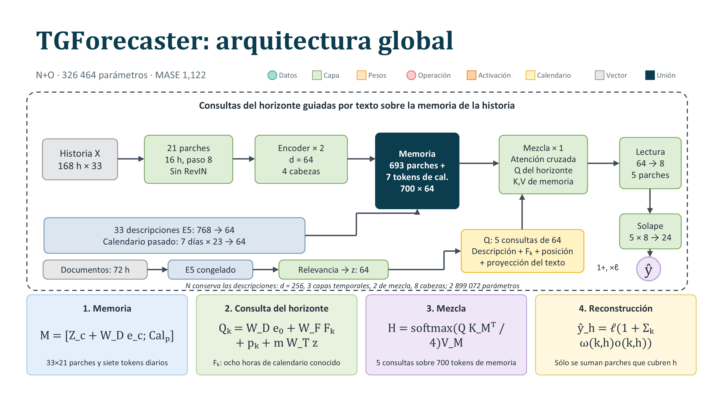
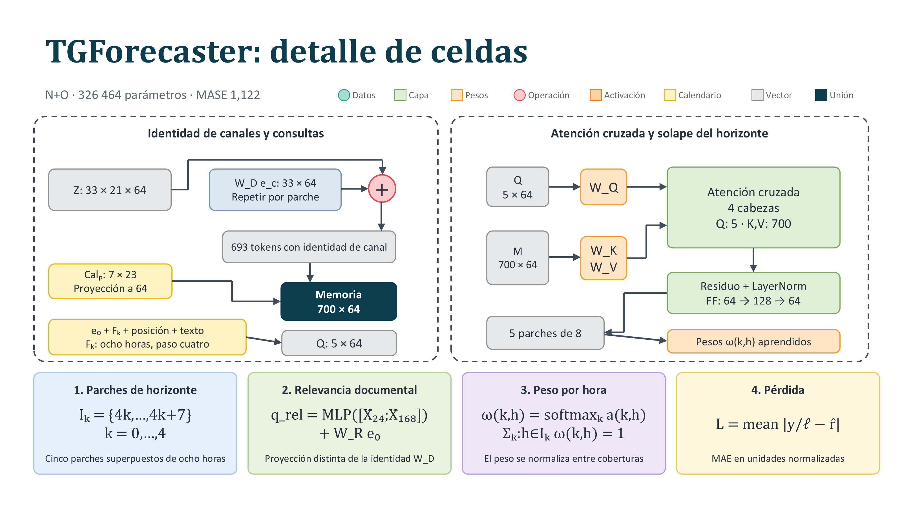

(e2-tgforecaster)=
# 10.12. TGForecaster: consultas del horizonte guiadas por texto

La {ref}`notación y las operaciones compartidas <fundamentos-arquitecturas>` definen los tensores, el nivel de demanda, la atención, las activaciones y la optimización.

## Arquitectura y fundamentos

TGForecaster utiliza descripciones textuales de los canales para orientar la relación entre información documental y señales numéricas. La atención cruzada distingue qué se pregunta —tokens del horizonte— de dónde se busca la respuesta —la memoria de la historia—. La variante N conserva las descripciones estáticas de canales y no incorpora documentos que cambien por origen; N+O añade el contexto documental oficial disponible.

Cada uno de los 33 canales históricos se divide en 21 parches de 16 horas con paso ocho. Sus embeddings se codifican y se suman a una proyección de la descripción E5 del canal; siete tokens adicionales representan el calendario diario pasado. La memoria reúne así $33\times21+7=700$ tokens. No se aplica RevIN dentro de este codificador; la normalización externa del contrato permanece.

El horizonte de 24 horas se divide en cinco parches de ocho con paso cuatro. La consulta de cada parche combina descripción de demanda, calendario futuro conocido, posición y resumen de documentos oficiales disponibles en el origen:

$$
q_k=W_DE_{dem}+W_FF_k+p_k+m_tW_Tz_t,\quad
H=\operatorname{softmax}\!\left(\frac{QK_M^\top}{\sqrt{d_k}}\right)V_M.
$$ (eq-arquitecturas-tgforecaster-001)

El texto participa como parte de la consulta; las claves y valores proceden de la memoria numérica. Cada token decodifica ocho correcciones. Para las horas cubiertas por varios parches se aprende una combinación convexa: $\omega_{k,h}=\operatorname{softmax}_{k:h\in k}(a_{k,h})$, de modo que $\sum_k\omega_{k,h}=1$. La salida es $\ell_t[1+\sum_k\omega_{k,h}o_{k,h}]$.

El paquete adapta el artículo a una sola serie objetivo y a documentos disponibles al emitir el pronóstico; no incorpora texto realizado durante el horizonte. Las descripciones y los embeddings son extractores congelados; la selección documental y la fusión son entrenables. La variante N selecciona dimensión256, tres capas temporales, dos de mezcla y ocho cabezas; N+O selecciona dimensión64, dos capas temporales, una de mezcla y cuatro cabezas. Sus configuraciones distintas hacen que el contraste estime el procedimiento completo de selección, además de la incorporación de documentos.

### Esquema global

[](../_static/arquitecturas_presentacion/tgforecaster_global.png)

La historia se divide en parches y se combina con descripciones estáticas de las 33 variables. El calendario pasado completa una memoria de 700 tokens. Cinco consultas incorporan el calendario del horizonte, la descripción de demanda y el resumen documental; la atención cruzada genera parches de pronóstico superpuestos.

### Detalle de las operaciones

[](../_static/arquitecturas_presentacion/tgforecaster_detalle.png)

La identidad de cada variable se proyecta sobre sus parches históricos. Las consultas del horizonte atienden esa memoria y producen cinco parches de ocho horas, desplazados cuatro horas. Pesos aprendidos, normalizados entre los parches que cubren cada hora, reconstruyen las 24 salidas. La variante numérica conserva las descripciones estáticas y omite los documentos.

El {ref}`código de exportación de los esquemas <exportacion-esquemas>` forma parte del preprocesamiento compartido.

### Código de la arquitectura

```{literalinclude} ../_static/codigo_e2/tgforecaster_red.py
:language: python
:linenos:
```

<!-- diseno-entrenamiento:inicio -->

## Diseño de entrenamiento y prueba

(diseno-entrenamiento-tgforecaster-n)=

### TGForecaster · N

Se evaluaron **20 configuraciones** y 5 llegaron a la comparación de selección. La **configuración 19** obtuvo el menor MASE de validación (0,7047) sobre 2018–2021. La configuración fijada para prueba es **19**, con 5 semillas.

#### Configuración conservada
| Parámetro | Valor |
|---|---|
| Dimensión interna | 256 |
| Capas | 3 |
| Capas de mezcla | 2 |
| Cabezas | 8 |
| Dropout | 0,1 |
| Tasa de aprendizaje | 0,0001 |
| Decaimiento de pesos | 0,0001 |
| Lote de ajuste | 32 |

#### Etapas del entrenamiento y prueba

| Etapa | Especificación |
|---|---|
| Filtro inicial | 20 configuraciones; semilla 43; validación 2018 |
| Confirmación y criterio | Cinco finalistas; semilla 43; evaluación adicional 2019–2021; media de los cuatro años 2018–2021. Menor MASE medio de validación; cada año tiene el mismo peso. |
| Ajuste final | 2000-01-09 00:00:00-05:00 a 2019-10-20 00:00:00-05:00 |
| Parada interna final | 2019-10-21 00:00:00-05:00 a 2021-12-31 00:00:00-05:00 |
| Prueba | 2022-01-01 a 2025-12-31; 1.461 orígenes diarios |
| Semillas finales | 1000, 1001, 1002, 1003, 1004 |
| Historia y horizonte | 168 y 24 horas, respectivamente |
| Pérdida y optimizador | MAE de demanda dividida por el nivel histórico; AdamW |
| Épocas y parada | Máximo 200; mínimo 10; paciencia efectiva 6; restauración del menor valor interno |
| Tasa de aprendizaje | ReduceLROnPlateau: factor 0,5; paciencia 2 |
| Lotes | Ajuste: 32; evaluación de prueba: hasta 256 orígenes por lote |
| Épocas ejecutadas | 36–48; épocas de los checkpoints: 40, 30, 41, 36, 42 |


#### Configuraciones evaluadas en desarrollo
El filtro y la selección corresponden a periodos y cantidades de repeticiones distintos. El guion identifica las configuraciones que no avanzaron a confirmación; no representa un resultado nulo.
| Configuración | Hiperparámetros | MASE del filtro | MASE de validación | Estado |
|---|---|---:|---:|---|
| **19** | Dimensión interna: 256; Capas: 3; Capas de mezcla: 2; Cabezas: 8; Dropout: 0,1; Tasa de aprendizaje: 0,0001; Decaimiento de pesos: 0,0001; Lote de ajuste: 32 | 0,4628 | 0,7047 | **Seleccionada para prueba** |
| 1 | Dimensión interna: 64; Capas: 2; Capas de mezcla: 1; Cabezas: 4; Dropout: 0,1; Tasa de aprendizaje: 0,001; Decaimiento de pesos: 0,0001; Lote de ajuste: 64 | 0,5293 | 0,7261 | Finalista |
| 12 | Dimensión interna: 128; Capas: 3; Capas de mezcla: 3; Cabezas: 8; Dropout: 0,3; Tasa de aprendizaje: 0,001; Decaimiento de pesos: 0,01; Lote de ajuste: 128 | 0,7403 | 0,9152 | Finalista |
| 15 | Dimensión interna: 32; Capas: 3; Capas de mezcla: 1; Cabezas: 4; Dropout: 0,1; Tasa de aprendizaje: 0,001; Decaimiento de pesos: 0,0001; Lote de ajuste: 64 | 0,7349 | 0,9257 | Finalista |
| 7 | Dimensión interna: 128; Capas: 2; Capas de mezcla: 1; Cabezas: 8; Dropout: 0,1; Tasa de aprendizaje: 0,0003; Decaimiento de pesos: 0,0001; Lote de ajuste: 64 | 0,6672 | 0,9331 | Finalista |
| 2 | Dimensión interna: 64; Capas: 2; Capas de mezcla: 2; Cabezas: 4; Dropout: 0,2; Tasa de aprendizaje: 0,001; Decaimiento de pesos: 0,0001; Lote de ajuste: 64 | 0,7680 | — | Filtro inicial |
| 10 | Dimensión interna: 128; Capas: 3; Capas de mezcla: 2; Cabezas: 8; Dropout: 0,1; Tasa de aprendizaje: 0,0001; Decaimiento de pesos: 0,0001; Lote de ajuste: 32 | 0,8162 | — | Filtro inicial |
| 5 | Dimensión interna: 64; Capas: 3; Capas de mezcla: 3; Cabezas: 4; Dropout: 0,3; Tasa de aprendizaje: 0,001; Decaimiento de pesos: 0,001; Lote de ajuste: 128 | 0,8367 | — | Filtro inicial |
| 9 | Dimensión interna: 128; Capas: 3; Capas de mezcla: 1; Cabezas: 8; Dropout: 0,2; Tasa de aprendizaje: 0,001; Decaimiento de pesos: 0,001; Lote de ajuste: 128 | 0,8498 | — | Filtro inicial |
| 16 | Dimensión interna: 32; Capas: 3; Capas de mezcla: 2; Cabezas: 4; Dropout: 0,2; Tasa de aprendizaje: 0,001; Decaimiento de pesos: 0,001; Lote de ajuste: 64 | 0,8522 | — | Filtro inicial |
| 6 | Dimensión interna: 64; Capas: 2; Capas de mezcla: 3; Cabezas: 4; Dropout: 0,1; Tasa de aprendizaje: 0,0001; Decaimiento de pesos: 0,0001; Lote de ajuste: 32 | 0,8524 | — | Filtro inicial |
| 11 | Dimensión interna: 128; Capas: 3; Capas de mezcla: 3; Cabezas: 8; Dropout: 0,2; Tasa de aprendizaje: 0,0003; Decaimiento de pesos: 0,001; Lote de ajuste: 64 | 0,8664 | — | Filtro inicial |
| 18 | Dimensión interna: 256; Capas: 2; Capas de mezcla: 1; Cabezas: 8; Dropout: 0,2; Tasa de aprendizaje: 0,0001; Decaimiento de pesos: 0,001; Lote de ajuste: 32 | 0,9454 | — | Filtro inicial |
| 8 | Dimensión interna: 128; Capas: 2; Capas de mezcla: 2; Cabezas: 8; Dropout: 0,2; Tasa de aprendizaje: 0,0003; Decaimiento de pesos: 0,0001; Lote de ajuste: 64 | 0,9699 | — | Filtro inicial |
| 4 | Dimensión interna: 64; Capas: 3; Capas de mezcla: 2; Cabezas: 4; Dropout: 0,1; Tasa de aprendizaje: 0,0003; Decaimiento de pesos: 0,001; Lote de ajuste: 128 | 1,0103 | — | Filtro inicial |
| 20 | Dimensión interna: 256; Capas: 2; Capas de mezcla: 2; Cabezas: 8; Dropout: 0,3; Tasa de aprendizaje: 0,0003; Decaimiento de pesos: 0,01; Lote de ajuste: 128 | 1,2870 | — | Filtro inicial |
| 13 | Dimensión interna: 128; Capas: 2; Capas de mezcla: 3; Cabezas: 16; Dropout: 0,2; Tasa de aprendizaje: 0,0001; Decaimiento de pesos: 0,0001; Lote de ajuste: 128 | 1,5243 | — | Filtro inicial |
| 3 | Dimensión interna: 64; Capas: 3; Capas de mezcla: 1; Cabezas: 4; Dropout: 0,2; Tasa de aprendizaje: 0,0003; Decaimiento de pesos: 0,0001; Lote de ajuste: 64 | 1,5583 | — | Filtro inicial |
| 14 | Dimensión interna: 128; Capas: 3; Capas de mezcla: 2; Cabezas: 16; Dropout: 0,3; Tasa de aprendizaje: 0,0003; Decaimiento de pesos: 0,0001; Lote de ajuste: 64 | 1,6427 | — | Filtro inicial |
| 17 | Dimensión interna: 32; Capas: 2; Capas de mezcla: 3; Cabezas: 4; Dropout: 0,3; Tasa de aprendizaje: 0,0003; Decaimiento de pesos: 0,0001; Lote de ajuste: 128 | 1,6490 | — | Filtro inicial |

[Resultados de desarrollo por año y semilla](../_static/resultados/diseno_entrenamiento/adj_modelo7_20261114_0430__N.csv) · [Configuraciones completas](../_static/resultados/diseno_entrenamiento/adj_modelo7_20261114_0430__N_configuraciones.csv).


(diseno-entrenamiento-tgforecaster-no)=

### TGForecaster · N+O

Se evaluaron **20 configuraciones** y 5 llegaron a la comparación de selección. La **configuración 1** obtuvo el menor MASE de validación (0,9126) sobre 2018–2021. La configuración fijada para prueba es **1**, con 5 semillas.

#### Configuración conservada
| Parámetro | Valor |
|---|---|
| Dimensión interna | 64 |
| Capas | 2 |
| Capas de mezcla | 1 |
| Cabezas | 4 |
| Dropout | 0,1 |
| Tasa de aprendizaje | 0,001 |
| Decaimiento de pesos | 0,0001 |
| Lote de ajuste | 64 |

#### Etapas del entrenamiento y prueba

| Etapa | Especificación |
|---|---|
| Filtro inicial | 20 configuraciones; semilla 43; validación 2018 |
| Confirmación y criterio | Cinco finalistas; semilla 43; evaluación adicional 2019–2021; media de los cuatro años 2018–2021. Menor MASE medio de validación; cada año tiene el mismo peso. |
| Ajuste final | 2000-01-09 00:00:00-05:00 a 2019-10-20 00:00:00-05:00 |
| Parada interna final | 2019-10-21 00:00:00-05:00 a 2021-12-31 00:00:00-05:00 |
| Prueba | 2022-01-01 a 2025-12-31; 1.461 orígenes diarios |
| Semillas finales | 1000, 1001, 1002, 1003, 1004 |
| Historia y horizonte | 168 y 24 horas, respectivamente |
| Pérdida y optimizador | MAE de demanda dividida por el nivel histórico; AdamW |
| Épocas y parada | Máximo 200; mínimo 10; paciencia efectiva 6; restauración del menor valor interno |
| Tasa de aprendizaje | ReduceLROnPlateau: factor 0,5; paciencia 2 |
| Lotes | Ajuste: 64; evaluación de prueba: hasta 256 orígenes por lote |
| Épocas ejecutadas | 23–45; épocas de los checkpoints: 29, 20, 25, 39, 17 |


#### Configuraciones evaluadas en desarrollo
El filtro y la selección corresponden a periodos y cantidades de repeticiones distintos. El guion identifica las configuraciones que no avanzaron a confirmación; no representa un resultado nulo.
| Configuración | Hiperparámetros | MASE del filtro | MASE de validación | Estado |
|---|---|---:|---:|---|
| **1** | Dimensión interna: 64; Capas: 2; Capas de mezcla: 1; Cabezas: 4; Dropout: 0,1; Tasa de aprendizaje: 0,001; Decaimiento de pesos: 0,0001; Lote de ajuste: 64 | 0,7176 | 0,9126 | **Seleccionada para prueba** |
| 19 | Dimensión interna: 256; Capas: 3; Capas de mezcla: 2; Cabezas: 8; Dropout: 0,1; Tasa de aprendizaje: 0,0001; Decaimiento de pesos: 0,0001; Lote de ajuste: 32 | 0,7240 | 0,9179 | Finalista |
| 12 | Dimensión interna: 128; Capas: 3; Capas de mezcla: 3; Cabezas: 8; Dropout: 0,3; Tasa de aprendizaje: 0,001; Decaimiento de pesos: 0,01; Lote de ajuste: 128 | 0,7703 | 1,0030 | Finalista |
| 2 | Dimensión interna: 64; Capas: 2; Capas de mezcla: 2; Cabezas: 4; Dropout: 0,2; Tasa de aprendizaje: 0,001; Decaimiento de pesos: 0,0001; Lote de ajuste: 64 | 0,7562 | 1,0456 | Finalista |
| 4 | Dimensión interna: 64; Capas: 3; Capas de mezcla: 2; Cabezas: 4; Dropout: 0,1; Tasa de aprendizaje: 0,0003; Decaimiento de pesos: 0,001; Lote de ajuste: 128 | 0,7652 | 1,0566 | Finalista |
| 10 | Dimensión interna: 128; Capas: 3; Capas de mezcla: 2; Cabezas: 8; Dropout: 0,1; Tasa de aprendizaje: 0,0001; Decaimiento de pesos: 0,0001; Lote de ajuste: 32 | 0,7753 | — | Filtro inicial |
| 6 | Dimensión interna: 64; Capas: 2; Capas de mezcla: 3; Cabezas: 4; Dropout: 0,1; Tasa de aprendizaje: 0,0001; Decaimiento de pesos: 0,0001; Lote de ajuste: 32 | 0,7833 | — | Filtro inicial |
| 7 | Dimensión interna: 128; Capas: 2; Capas de mezcla: 1; Cabezas: 8; Dropout: 0,1; Tasa de aprendizaje: 0,0003; Decaimiento de pesos: 0,0001; Lote de ajuste: 64 | 0,7873 | — | Filtro inicial |
| 11 | Dimensión interna: 128; Capas: 3; Capas de mezcla: 3; Cabezas: 8; Dropout: 0,2; Tasa de aprendizaje: 0,0003; Decaimiento de pesos: 0,001; Lote de ajuste: 64 | 0,8069 | — | Filtro inicial |
| 15 | Dimensión interna: 32; Capas: 3; Capas de mezcla: 1; Cabezas: 4; Dropout: 0,1; Tasa de aprendizaje: 0,001; Decaimiento de pesos: 0,0001; Lote de ajuste: 64 | 0,8106 | — | Filtro inicial |
| 16 | Dimensión interna: 32; Capas: 3; Capas de mezcla: 2; Cabezas: 4; Dropout: 0,2; Tasa de aprendizaje: 0,001; Decaimiento de pesos: 0,001; Lote de ajuste: 64 | 0,8597 | — | Filtro inicial |
| 8 | Dimensión interna: 128; Capas: 2; Capas de mezcla: 2; Cabezas: 8; Dropout: 0,2; Tasa de aprendizaje: 0,0003; Decaimiento de pesos: 0,0001; Lote de ajuste: 64 | 0,8765 | — | Filtro inicial |
| 9 | Dimensión interna: 128; Capas: 3; Capas de mezcla: 1; Cabezas: 8; Dropout: 0,2; Tasa de aprendizaje: 0,001; Decaimiento de pesos: 0,001; Lote de ajuste: 128 | 0,8978 | — | Filtro inicial |
| 18 | Dimensión interna: 256; Capas: 2; Capas de mezcla: 1; Cabezas: 8; Dropout: 0,2; Tasa de aprendizaje: 0,0001; Decaimiento de pesos: 0,001; Lote de ajuste: 32 | 0,9014 | — | Filtro inicial |
| 3 | Dimensión interna: 64; Capas: 3; Capas de mezcla: 1; Cabezas: 4; Dropout: 0,2; Tasa de aprendizaje: 0,0003; Decaimiento de pesos: 0,0001; Lote de ajuste: 64 | 0,9160 | — | Filtro inicial |
| 5 | Dimensión interna: 64; Capas: 3; Capas de mezcla: 3; Cabezas: 4; Dropout: 0,3; Tasa de aprendizaje: 0,001; Decaimiento de pesos: 0,001; Lote de ajuste: 128 | 1,0757 | — | Filtro inicial |
| 14 | Dimensión interna: 128; Capas: 3; Capas de mezcla: 2; Cabezas: 16; Dropout: 0,3; Tasa de aprendizaje: 0,0003; Decaimiento de pesos: 0,0001; Lote de ajuste: 64 | 1,0889 | — | Filtro inicial |
| 13 | Dimensión interna: 128; Capas: 2; Capas de mezcla: 3; Cabezas: 16; Dropout: 0,2; Tasa de aprendizaje: 0,0001; Decaimiento de pesos: 0,0001; Lote de ajuste: 128 | 1,2778 | — | Filtro inicial |
| 17 | Dimensión interna: 32; Capas: 2; Capas de mezcla: 3; Cabezas: 4; Dropout: 0,3; Tasa de aprendizaje: 0,0003; Decaimiento de pesos: 0,0001; Lote de ajuste: 128 | 1,4525 | — | Filtro inicial |
| 20 | Dimensión interna: 256; Capas: 2; Capas de mezcla: 2; Cabezas: 8; Dropout: 0,3; Tasa de aprendizaje: 0,0003; Decaimiento de pesos: 0,01; Lote de ajuste: 128 | 1,4644 | — | Filtro inicial |

[Resultados de desarrollo por año y semilla](../_static/resultados/diseno_entrenamiento/adj_modelo7_20261114_0430__N+O.csv) · [Configuraciones completas](../_static/resultados/diseno_entrenamiento/adj_modelo7_20261114_0430__N+O_configuraciones.csv).

<!-- diseno-entrenamiento:fin -->

## Pipeline de entrenamiento y prueba

<!-- entrenamiento-portable:inicio -->
### Comandos de entrenamiento y evaluación

Validación temporal de la configuración seleccionada:

```bash
python scripts/entrenar_arquitectura.py --modelo tgforecaster --anio 2021 --semilla 1000 --dispositivo auto --salida salidas/tgforecaster_validacion_1000
```

Comprobación funcional breve:

```bash
python scripts/entrenar_arquitectura.py --modelo tgforecaster --smoke --dispositivo cpu --salida salidas/tgforecaster_funcional
```

Evaluación final, con ajuste y parada anteriores a 2022:

```bash
python scripts/entrenar_arquitectura.py --modelo tgforecaster --fase prueba --allow-test --semilla 1000 --dispositivo auto --salida salidas/tgforecaster_prueba_1000
```

El código completo de preparación, optimización, guardado y restauración está en el {ref}`pipeline ejecutable compartido <entrenamiento-portable>`. Cada salida debe ser una carpeta nueva.

El control numérico con descripciones estáticas se ejecuta con `--modelo tgforecaster_n`; la variante `tgforecaster` incorpora los documentos oficiales.
<!-- entrenamiento-portable:fin -->

El pipeline fija el plan y las huellas de entrada, genera ventanas cronológicas, ajusta las transformaciones por pliegue y evalúa 20 candidatos en 2018. Confirma cinco finalistas en 2019–2021, selecciona por MASE medio y reajusta con cinco semillas finales usando la reserva interna anterior a 2022. La lectura de la prueba solo ocurre después de cerrar la selección. El libro muestra las implementaciones y no llama al entrenamiento.

### Datos, referencias y escaladores por pliegue

```{literalinclude} ../_static/codigo_e2/Modelo7_TGForecaster/src/entrenamiento/datos.py
:language: python
:linenos:
```

### Bucle de ajuste y predicción

```{literalinclude} ../_static/codigo_e2/Modelo7_TGForecaster/src/entrenamiento/motor.py
:language: python
:linenos:
```

### Búsqueda, confirmación y evaluación final

```{literalinclude} ../_static/codigo_e2/Modelo7_TGForecaster/src/entrenamiento/protocolo.py
:language: python
:linenos:
```

### Disponibilidad, embeddings y preparación del texto

```{literalinclude} ../_static/codigo_e2/Modelo7_TGForecaster/src/entrenamiento/texto.py
:language: python
:linenos:
```

### Ejecución

El {ref}`pipeline común <entrenamiento-portable>` utiliza las fuentes de esta ficha y la configuración seleccionada. Los siguientes comandos ejecutan el ajuste y la evaluación.

La configuración exacta del paquete se conserva a continuación. Identifica variantes, candidatos, semillas, parada y presupuesto; se mantiene separada de las métricas calculadas a partir de artefactos.

```{literalinclude} ../_static/codigo_e2/Modelo7_TGForecaster/config/modelo.json
:language: json
```


## Evaluación

Las variantes N y N+O conservan cinco semillas finales cada una, con métricas y predicciones para 2022–2025. Su contraste documental y la inferencia conjunta se presentan en la {ref}`evaluación integrada <evaluacion-e2>`. Las descripciones estáticas están presentes en ambas variantes; la comparación aísla el procedimiento con y sin documentos oficiales variables en el tiempo, con hiperparámetros seleccionados por separado.

## Fuentes

[Xu et al., TGForecaster, versión 2](https://arxiv.org/html/2405.13522v2). La descripción corresponde a la implementación del experimento; las adaptaciones se identifican en el texto.
