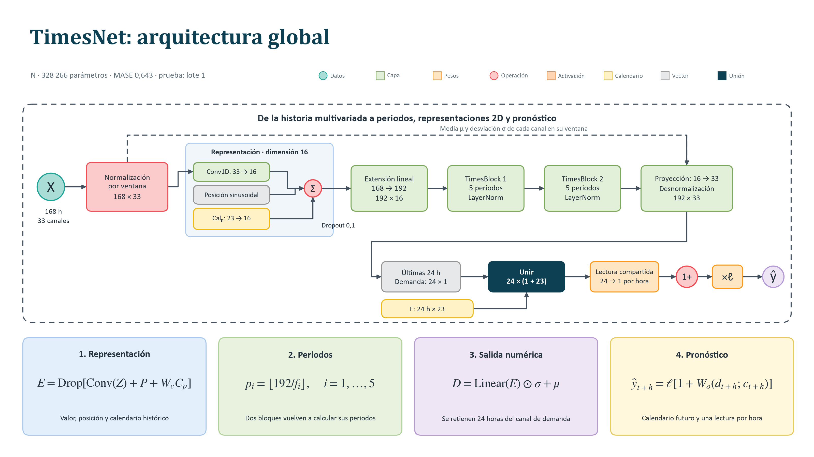
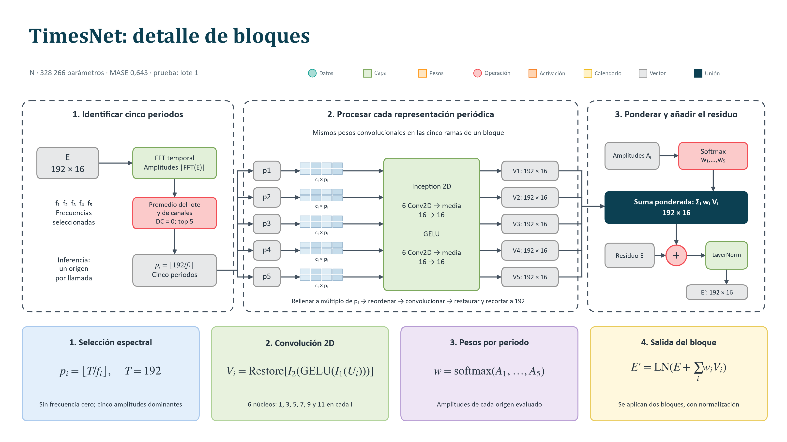

(e2-timesnet)=
# 10.15. TimesNet: variación temporal bidimensional

## Arquitectura y fundamentos

TimesNet representa una serie en dos dimensiones: posición dentro de un ciclo y posición entre ciclos. Primero identifica periodos mediante la transformada de Fourier. Para cada periodo reorganiza la historia como una matriz y aplica convoluciones bidimensionales, que pueden aprender variaciones dentro del ciclo y entre ciclos. Después devuelve cada representación al eje temporal y combina sus resultados según la amplitud de las frecuencias seleccionadas.

La entrada contiene 168 horas y 33 canales: 30 variables históricas y tres máscaras. Se normaliza cada canal con la media y desviación de su propia ventana; esta operación usa exclusivamente historia disponible. Una convolución de valores, una representación posicional y una proyección del calendario histórico producen vectores de dimensión 16. Una capa lineal extiende el eje temporal de 168 a 192 posiciones.

$$
Z=(X-\mu_t)/\sqrt{\sigma_t^2+10^{-5}},\qquad
E=\operatorname{Conv1D}(Z)+P+W_cC_p.
$$ (eq-arquitecturas-timesnet-001)

Cada uno de los dos TimesBlock selecciona cinco frecuencias dominantes. Para $T=192$, la frecuencia $f_i$ determina $p_i=\lfloor T/f_i\rfloor$. El relleno permite reorganizar los vectores como una matriz de ciclos por periodo; un módulo Inception con seis tamaños de núcleo extrae patrones bidimensionales.

$$
U_i=\operatorname{reshape}_{p_i}(E),\quad
V_i=\operatorname{restore}(\operatorname{Inception2D}(U_i)),\quad
E'=\operatorname{LayerNorm}\left(E+\sum_{i=1}^{5}w_iV_i\right),\quad
w=\operatorname{softmax}(A).
$$ (eq-arquitecturas-timesnet-002)

La proyección final recupera 33 canales y revierte la normalización por ventana. El canal de demanda de las últimas 24 posiciones se combina con el calendario futuro mediante una lectura lineal compartida, y el nivel de demanda $\ell_t$ restituye las unidades: $\widehat y_{t+h}=\ell_t[1+W_o(d_{t+h},C_{t+h})]$. Hay 328.266 parámetros entrenables. El coste combina FFT $O(Td\log T)$ y convoluciones sobre cinco representaciones periódicas por bloque.

La selección de frecuencias del código oficial promedia amplitudes sobre los elementos del lote. Por ello la prueba recibe un único origen por llamada: cada pronóstico depende de su propia historia. La validación y las métricas conservadas de parada corresponden al protocolo de ajuste registrado; la inferencia de prueba y de perturbaciones usa lote uno.

La implementación reutiliza TimesBlock e Inception de [Wu et al., TimesNet, ICLR 2023](https://arxiv.org/abs/2210.02186), con calendario histórico y lectura futura adaptados al panel multivariado.

## Esquema global

[](../_static/arquitecturas_presentacion/timesnet_global.png)

La transformación periódica permite combinar dependencias dentro y entre ciclos; la lectura final incorpora el calendario conocido.

## Detalle de las operaciones

[](../_static/arquitecturas_presentacion/timesnet_detalle.png)

Los pesos por frecuencia agregan cinco representaciones, sin utilizar observaciones posteriores al origen de pronóstico.

El {ref}`código de generación de estos esquemas <esquemas-top10-detallados>` conserva sus dimensiones y conexiones.


## Código de la arquitectura

```{literalinclude} ../_static/codigo_e2/timesnet_red.py
:language: python
:linenos:
```


### Bloque periódico y convolución de múltiples escalas

```{literalinclude} ../_static/codigo_e2/top10_adicionales/src/vendor/timesnet/TimesNet.py
:language: python
:pyobject: FFT_for_Period
:linenos:
```

```{literalinclude} ../_static/codigo_e2/top10_adicionales/src/vendor/timesnet/TimesNet.py
:language: python
:pyobject: TimesBlock
:linenos:
```

```{literalinclude} ../_static/codigo_e2/top10_adicionales/src/vendor/timesnet/layers/Conv_Blocks.py
:language: python
:pyobject: Inception_Block_V1
:linenos:
```

<!-- diseno-entrenamiento:inicio -->

## Diseño de entrenamiento y prueba

(diseno-entrenamiento-timesnet)=

### Selección en validación

Se evaluaron **20 configuraciones** y 5 llegaron a la comparación de selección. La **configuración 19** obtuvo el menor MASE de validación (0,5244) sobre 2018–2021. La configuración fijada para prueba es **19**, con 5 semillas.

#### Configuración conservada
| Parámetro | Valor |
|---|---|
| Bloques TimesNet | 2 |
| Periodos FFT | 5 |
| Núcleos Inception | 6 |
| Dimensión interna | 16 |
| Dimensión convolucional | 16 |
| Dropout | 0,1 |
| Tasa de aprendizaje | 0,000534428 |
| Decaimiento de pesos | 0 |
| Lote de ajuste | 64 |

#### Etapas del entrenamiento y prueba

| Etapa | Especificación |
|---|---|
| Filtro inicial | 20 configuraciones; semilla 43; validación 2018 |
| Confirmación y criterio | Cinco finalistas; semilla 43; evaluación adicional 2019–2021; media de los cuatro años 2018–2021. Menor MASE medio de validación; cada año tiene el mismo peso. |
| Ajuste final | 2000-01-09 00:00:00-05:00 a 2019-10-20 00:00:00-05:00 |
| Parada interna final | 2019-10-21 00:00:00-05:00 a 2021-12-31 00:00:00-05:00 |
| Prueba | 2022-01-01 a 2025-12-31; 1.461 orígenes diarios |
| Semillas finales | 1000, 1001, 1002, 1003, 1004 |
| Historia y horizonte | 168 y 24 horas, respectivamente |
| Pérdida y optimizador | MAE de demanda dividida por el nivel histórico; AdamW |
| Épocas y parada | Máximo 200; mínimo 10; paciencia efectiva 6; restauración del menor valor interno |
| Tasa de aprendizaje | ReduceLROnPlateau: factor 0,5; paciencia 2 |
| Lotes | Ajuste: 64; evaluación de prueba: hasta 1 orígenes por lote |
| Épocas ejecutadas | 27–47; épocas de los checkpoints: 32, 41, 41, 39, 21 |

La selección de hiperparámetros utiliza evaluación con lote 256. La prueba utiliza lote uno: los periodos FFT se determinan por origen, con los mismos pesos y configuración seleccionada.

#### Configuraciones evaluadas en desarrollo
El filtro y la selección corresponden a periodos y cantidades de repeticiones distintos. El guion identifica las configuraciones que no avanzaron a confirmación; no representa un resultado nulo.
| Configuración | Hiperparámetros | MASE del filtro | MASE de validación | Estado |
|---|---|---:|---:|---|
| **19** | Bloques TimesNet: 2; Periodos FFT: 5; Núcleos Inception: 6; Dimensión interna: 16; Dimensión convolucional: 16; Dropout: 0,1; Tasa de aprendizaje: 0,000534428; Decaimiento de pesos: 0; Lote de ajuste: 64 | 0,4281 | 0,5244 | **Seleccionada para prueba** |
| 15 | Bloques TimesNet: 2; Periodos FFT: 5; Núcleos Inception: 6; Dimensión interna: 16; Dimensión convolucional: 32; Dropout: 0,1; Tasa de aprendizaje: 0,000237974; Decaimiento de pesos: 0; Lote de ajuste: 32 | 0,4208 | 0,5304 | Finalista |
| 11 | Bloques TimesNet: 2; Periodos FFT: 5; Núcleos Inception: 6; Dimensión interna: 16; Dimensión convolucional: 16; Dropout: 0,1; Tasa de aprendizaje: 0,000208311; Decaimiento de pesos: 0; Lote de ajuste: 32 | 0,4287 | 0,5378 | Finalista |
| 10 | Bloques TimesNet: 2; Periodos FFT: 5; Núcleos Inception: 6; Dimensión interna: 64; Dimensión convolucional: 64; Dropout: 0,1; Tasa de aprendizaje: 0,000199641; Decaimiento de pesos: 0; Lote de ajuste: 64 | 0,4259 | 0,5473 | Finalista |
| 18 | Bloques TimesNet: 2; Periodos FFT: 5; Núcleos Inception: 6; Dimensión interna: 64; Dimensión convolucional: 64; Dropout: 0,1; Tasa de aprendizaje: 0,000168177; Decaimiento de pesos: 0,0001; Lote de ajuste: 64 | 0,4268 | 0,5505 | Finalista |
| 9 | Bloques TimesNet: 2; Periodos FFT: 5; Núcleos Inception: 6; Dimensión interna: 32; Dimensión convolucional: 32; Dropout: 0,1; Tasa de aprendizaje: 0,000176993; Decaimiento de pesos: 0; Lote de ajuste: 16 | 0,4368 | — | Filtro inicial |
| 5 | Bloques TimesNet: 2; Periodos FFT: 5; Núcleos Inception: 6; Dimensión interna: 32; Dimensión convolucional: 64; Dropout: 0,1; Tasa de aprendizaje: 0,000186205; Decaimiento de pesos: 0,0001; Lote de ajuste: 16 | 0,4376 | — | Filtro inicial |
| 3 | Bloques TimesNet: 2; Periodos FFT: 5; Núcleos Inception: 6; Dimensión interna: 64; Dimensión convolucional: 128; Dropout: 0,1; Tasa de aprendizaje: 0,000138106; Decaimiento de pesos: 0,0001; Lote de ajuste: 32 | 0,4392 | — | Filtro inicial |
| 4 | Bloques TimesNet: 2; Periodos FFT: 5; Núcleos Inception: 6; Dimensión interna: 64; Dimensión convolucional: 128; Dropout: 0,1; Tasa de aprendizaje: 0,000106289; Decaimiento de pesos: 0; Lote de ajuste: 64 | 0,4398 | — | Filtro inicial |
| 8 | Bloques TimesNet: 2; Periodos FFT: 5; Núcleos Inception: 6; Dimensión interna: 64; Dimensión convolucional: 128; Dropout: 0,1; Tasa de aprendizaje: 0,000151512; Decaimiento de pesos: 0; Lote de ajuste: 64 | 0,4402 | — | Filtro inicial |
| 6 | Bloques TimesNet: 2; Periodos FFT: 5; Núcleos Inception: 6; Dimensión interna: 64; Dimensión convolucional: 128; Dropout: 0,1; Tasa de aprendizaje: 0,000229693; Decaimiento de pesos: 0; Lote de ajuste: 64 | 0,4433 | — | Filtro inicial |
| 13 | Bloques TimesNet: 2; Periodos FFT: 5; Núcleos Inception: 6; Dimensión interna: 16; Dimensión convolucional: 16; Dropout: 0,1; Tasa de aprendizaje: 0,000348605; Decaimiento de pesos: 0,0001; Lote de ajuste: 64 | 0,4466 | — | Filtro inicial |
| 14 | Bloques TimesNet: 2; Periodos FFT: 5; Núcleos Inception: 6; Dimensión interna: 16; Dimensión convolucional: 32; Dropout: 0,1; Tasa de aprendizaje: 0,000226818; Decaimiento de pesos: 0,0001; Lote de ajuste: 32 | 0,4485 | — | Filtro inicial |
| 2 | Bloques TimesNet: 2; Periodos FFT: 5; Núcleos Inception: 6; Dimensión interna: 32; Dimensión convolucional: 32; Dropout: 0,1; Tasa de aprendizaje: 0,000691839; Decaimiento de pesos: 0; Lote de ajuste: 16 | 0,4507 | — | Filtro inicial |
| 12 | Bloques TimesNet: 2; Periodos FFT: 5; Núcleos Inception: 6; Dimensión interna: 32; Dimensión convolucional: 32; Dropout: 0,1; Tasa de aprendizaje: 0,000359806; Decaimiento de pesos: 0,0001; Lote de ajuste: 16 | 0,4516 | — | Filtro inicial |
| 17 | Bloques TimesNet: 2; Periodos FFT: 5; Núcleos Inception: 6; Dimensión interna: 32; Dimensión convolucional: 64; Dropout: 0,1; Tasa de aprendizaje: 0,000763592; Decaimiento de pesos: 0; Lote de ajuste: 32 | 0,4517 | — | Filtro inicial |
| 20 | Bloques TimesNet: 2; Periodos FFT: 5; Núcleos Inception: 6; Dimensión interna: 32; Dimensión convolucional: 64; Dropout: 0,1; Tasa de aprendizaje: 0,000326529; Decaimiento de pesos: 0; Lote de ajuste: 16 | 0,4625 | — | Filtro inicial |
| 16 | Bloques TimesNet: 2; Periodos FFT: 5; Núcleos Inception: 6; Dimensión interna: 32; Dimensión convolucional: 64; Dropout: 0,1; Tasa de aprendizaje: 0,000300281; Decaimiento de pesos: 0,0001; Lote de ajuste: 16 | 0,4629 | — | Filtro inicial |
| 7 | Bloques TimesNet: 2; Periodos FFT: 5; Núcleos Inception: 6; Dimensión interna: 64; Dimensión convolucional: 64; Dropout: 0,1; Tasa de aprendizaje: 0,00088832; Decaimiento de pesos: 0; Lote de ajuste: 32 | 0,4709 | — | Filtro inicial |
| 1 | Bloques TimesNet: 2; Periodos FFT: 5; Núcleos Inception: 6; Dimensión interna: 64; Dimensión convolucional: 128; Dropout: 0,1; Tasa de aprendizaje: 0,000886804; Decaimiento de pesos: 0,0001; Lote de ajuste: 64 | 0,4740 | — | Filtro inicial |

[Resultados de desarrollo por año y semilla](../_static/resultados/diseno_entrenamiento/nuevo_timesnet__N.csv) · [Configuraciones completas](../_static/resultados/diseno_entrenamiento/nuevo_timesnet__N_configuraciones.csv).

<!-- diseno-entrenamiento:fin -->

## Pipeline de entrenamiento y prueba

<!-- entrenamiento-portable:inicio -->
### Comandos de entrenamiento y evaluación

Validación temporal de la configuración seleccionada:

```bash
python scripts/entrenar_arquitectura.py --modelo timesnet --anio 2021 --semilla 1000 --dispositivo auto --salida salidas/timesnet_validacion_1000
```

Comprobación funcional breve:

```bash
python scripts/entrenar_arquitectura.py --modelo timesnet --smoke --dispositivo cpu --salida salidas/timesnet_funcional
```

Evaluación final, con ajuste y parada anteriores a 2022:

```bash
python scripts/entrenar_arquitectura.py --modelo timesnet --fase prueba --allow-test --semilla 1000 --dispositivo auto --salida salidas/timesnet_prueba_1000
```

El código completo de preparación, optimización, guardado y restauración está en el {ref}`pipeline ejecutable compartido <entrenamiento-portable>`. Cada salida debe ser una carpeta nueva.
<!-- entrenamiento-portable:fin -->

Se comparan 20 configuraciones en 2018; cinco finalistas se evalúan en 2019–2021 y se selecciona la menor media de los cuatro años. El ajuste final utiliza cinco semillas (1000–1004), máximo de 200 épocas, mínimo de 10 y paciencia de 6. El checkpoint se restaura en el mínimo de parada interna. La reserva contiene 803 orígenes de 2019-10-21 a 2021-12-31; la prueba comprende 1.461 orígenes de 2022–2025. Las imputaciones y escalas se ajustan con el tramo de entrenamiento. Precio, hidrología y clima se usan como historia con sus rezagos de disponibilidad.

### Preparación de datos

```{literalinclude} ../_static/codigo_e2/top10_adicionales/src/entrenamiento/datos.py
:language: python
:linenos:
```

### Selección y ajuste con parada temprana

```{literalinclude} ../_static/codigo_e2/top10_adicionales/src/entrenamiento/protocolo_e2.py
:language: python
:pyobject: modelo_estandar
:linenos:
```

```{literalinclude} ../_static/codigo_e2/top10_adicionales/src/entrenamiento/protocolo.py
:language: python
:pyobject: corrida
:linenos:
```

### Optimización y restauración del checkpoint

```{literalinclude} ../_static/codigo_e2/top10_adicionales/src/entrenamiento/motor.py
:language: python
:pyobject: entrenar
:linenos:
```

### Prueba por origen con pesos congelados

El siguiente código restaura la configuración y los escaladores del checkpoint y obtiene las métricas sin modificar los pesos. TimesNet se evalúa con lote uno.

```{literalinclude} ../_static/codigo_e2/top10_adicionales/pipeline_prueba.py
:language: python
:linenos:
```

Los resultados, curvas de cinco semillas, métricas por horizonte y comparaciones están en la {ref}`evaluación integrada <evaluacion-e2>`.
